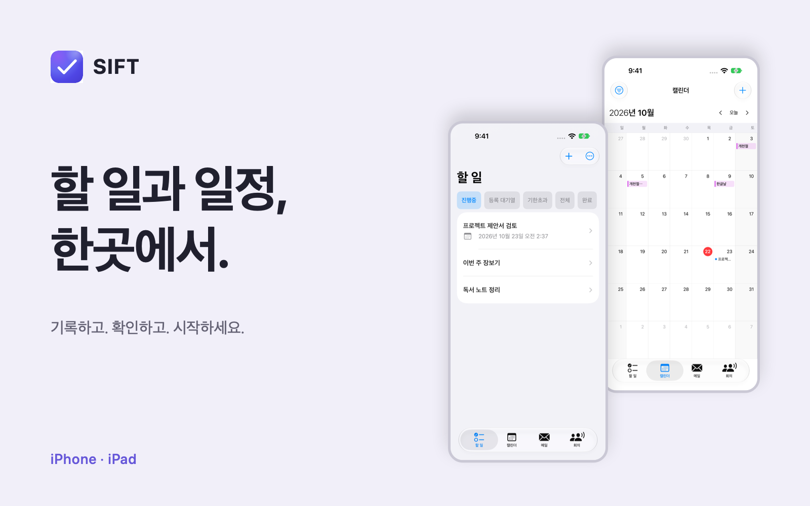

# SIFT

> 할 일을 직접 기록하고, 메일의 요청을 확인해 저장하며, 실제 마감부터 챙기는 iOS 중심 투두 앱

SIFT는 **기기 내 분석을 기본으로 하는 할 일 관리 앱**입니다. AI가 제안한 내용보다 원문과 사용자의 확인을 우선하며, 메일에 없는 마감일을 임의로 만들지 않습니다. 현재 개발 소스의 UI는 **한국어·영어·스페인어·일본어·중국어 간체·프랑스어·이탈리아어·독일어**를 지원합니다.

앱의 중심은 **할 일 작성·분류·완료**입니다. 메일·캘린더·회의와 AI는 이를 돕는 선택형 보조 기능이며, 연결이나 AI 없이도 기본 할 일 관리를 할 수 있습니다.

**[App Store에서 SIFT: To-Do List 무료 다운로드](https://apps.apple.com/kr/app/sift-to-do-list/id6782752844)**

소스 코드는 **[Apache License 2.0](LICENSE)**으로 제공합니다. 상업적 이용, 수정, 재배포와 비공개 파생 제품 개발이 가능합니다. 적용 조건과 제3자 구성요소의 경계는 아래 [라이선스](#라이선스)를 확인하세요.

## 다운로드와 개발 소스의 차이

현재 배포 대상은 **iOS/iPadOS 앱과 macOS용 Mac Catalyst 앱**입니다. 심사 제출한 `1.0.12 (11)`은 iOS/iPadOS 26.0 이상과 macOS 26.0 이상을 대상으로 하며 Mac 패키지는 Apple Silicon·Intel 통합 바이너리입니다. Mac 경로는 별도의 네이티브 AppKit 제품이 아니며, 온디바이스 AI의 하드웨어·모델 지원 조건은 별도입니다. Android 소스가 저장소에 있지만 현재 배포 중인 Android 제품이나 iOS와 동등한 지원을 뜻하지 않습니다.

- **출시 앱**: App Store 소개·버전 기록에는 할 일 관리, 온디바이스 정리, 이메일·캘린더 연동, 회의 기록과 Laya 메일 분류·화자/후처리 기능이 안내되어 있습니다. 실제 설치 버전의 기능은 앱 화면과 스토어의 버전 기록을 기준으로 확인하세요.
- **현재 공개 버전**: 2026-10-30 한국 App Store 조회에서 `1.0.11`과 공개 시각 `2026-10-27T00:04:33Z`를 확인했습니다. 10월 22일 빌드 10의 심사 대기 기록은 당시 상태이며 현재 출시 여부와 구분합니다.
- **심사 제출 버전 — 1.0.12 (11)**: 모바일 캘린더 보기·탐색과 Mac 일정 직접 편집, 녹음 상태·원음 보존·Apple 실시간 전사, 설정·선택형 AI 경로, Mac 오디오 가져오기와 할 일 편집 화면을 개선했습니다. 2026-10-30 두 플랫폼의 업로드 처리 `VALID`와 **06:51 KST 심사 접수·Waiting for Review**를 확인했습니다. 승인 후 자동 출시하며 실제 공개 완료는 아닙니다. [PR32](https://github.com/jung-geun/SIFT/pull/32)의 CI·보안 검사를 통과하고 원래 dev 이력을 보존하는 병합으로 main에 반영했습니다.
- **무료의 범위**: 앱 다운로드가 무료라는 뜻이지 ChatGPT 구독, 외부 제공자 사용량, 네트워크 비용이나 무제한 AI 요청이 포함된다는 뜻은 아닙니다. 선택형 제공자에는 해당 계정의 권한·모델 가용성·사용량 제한과 약관이 적용됩니다.

**[1.0.12 (11) 변경 요약·배포 상태](docs/changes.md#version-1-0-12-11)**에서 공개 `1.0.11` 이후의 변경을 확인할 수 있습니다. 이전 빌드의 사용 경로도 같은 문서에 보존합니다. 날짜별 개발 변경과 검증 범위는 [내부 개발 이력](docs/internal/development-history.md), 실제 실행·배포 근거는 [UI 테스트 계획](ios/UI_TEST_PLAN.md)에 기록합니다.

### 광고·개인정보 처리 안내

- **1.0.11 (10)부터의 광고 배치**: 할 일 화면의 카테고리 아래에 고정 **320×50 배너 하나만** 유지하며 전면(interstitial)·앱 시작(app-open)·보상형(rewarded) 광고는 넣지 않습니다. 목록과 함께 스크롤하거나 탭 아래에 표시하지 않습니다. 탭 전환마다 새 요청을 만들거나 자체 재시도·새로고침 타이머를 실행하지 않습니다. 온보딩·튜토리얼·키보드 표시·앱 비활성 상태와 광고 로드 실패에는 공간을 접습니다. Google Mobile Ads 13.11.0·UMP 3.1.0을 사용하며 Mac Catalyst에는 광고 SDK를 연결하지 않습니다.
- **테스트·운영 분리**: Debug·QA는 `-sift-test-ad-free` 실행 인자를 사용한 경우에만 내부 광고 없는 캡처 모드를 지원합니다. 이 인자는 일반 Release에서 무시하며 사용자 설정·구매 화면·구매 완료 플래그는 없습니다. 향후 검증된 광고 제거 이용 권한을 연결할 정책과 SDK 동의를 분리하되 아직 유료 기능을 제공하지 않습니다. 일반 테스트 실행은 Google 공식 테스트 광고를 사용합니다. 정식 iOS 실기기 Release에는 전달받은 앱 ID·배너 광고 단위 ID를 연결했습니다. 비개인 맞춤 요청(`npa=1`, publisher privacy treatment 비개인화), 게시자 퍼스트 파티 ID 비활성화·음소거는 SDK 시작/요청 전에 적용하며 UMP가 광고 요청을 허용해야 초기화합니다. 추적 허용 팝업은 요청하지 않습니다. 소스 통합과 실광고 승인·배포는 별개입니다.
- **공개 관찰(2026-10-19)**: [루트 app-ads.txt](https://sift.pieroot.xyz/app-ads.txt)는 **404**, 리디렉션 0회, 동일 최종 URL의 Pages HTML로 판매자 레코드가 없었습니다. [Apple lookup](https://itunes.apple.com/lookup?id=6782752844&country=us)의 `sellerUrl=https://sift.pieroot.xyz/`는 CNAME과 일치합니다. 다른 publisher나 공개 호스트 불일치는 관찰되지 않았으며, 제보된 AdMob 계정 불일치가 해결됐다는 뜻은 아닙니다.
- **실제 게시(2026-10-20)**: [PR 25](https://github.com/jung-geun/SIFT/pull/25)의 CI·보안 검사를 통과하고 `6ed9240258786fe2f6085d7712d41b917cce7603`으로 병합했습니다. [Pages 39407492409](https://github.com/jung-geun/SIFT/actions/runs/39407492409)가 성공했으며 같은 App Store 개발자 웹사이트 호스트의 [루트 app-ads.txt](https://sift.pieroot.xyz/app-ads.txt)에서 **HTTP 200·text/plain·리디렉션 0회**와 정확한 `google.com, pub-6070999186513755, DIRECT, f08c47fec0942fa0` 행을 확인했습니다. 이는 판매자 파일 게시 증거이며 AdMob 재크롤링·계정 불일치 해소·실광고 승인을 뜻하지 않습니다.
- **크롤러 호스트**: [Google 규칙](https://support.google.com/admob/answer/9363762?hl=en)은 `sift.pieroot.xyz`의 HTTPS·HTTP `/app-ads.txt`를 먼저, `pieroot.xyz`를 fallback으로 조회합니다. 부모 HTTPS 파일도 404였고 HTTP 후보는 조회하지 않았습니다. 부모 fallback 파일/리디렉션은 별도 호스팅 변경이며 이 Pages 파일 추가에 포함되지 않습니다.
- **개인정보 고지·심사 신고**: 2026-10-20 [개정 개인정보처리방침](https://sift.pieroot.xyz/privacy-policy.html)을 게시하고 실제 페이지를 확인했습니다. 시행일은 **2026-10-27**이며 기존 7일 사전 고지 약속에 맞춰 앱 출시도 같은 날 이후로 예약했습니다. App Store 개인정보 라벨에는 SDK의 대략적 위치·기기 ID·상호작용·광고·진단/성능 수집을 반영했습니다. AdMob **Privacy & messaging** 구성, 광고 단위 자동 새로고침 해제, 실제 지역별 필수 동의 화면과 광고 계정 재크롤링 완료는 이 제출 확인만으로 검증되지 않습니다.

## 사용자 안내와 제작 자료

[앱 소개](https://sift.pieroot.xyz/) · [사용 안내](https://sift.pieroot.xyz/workflows.html) · [이메일 연결](https://sift.pieroot.xyz/email-setup.html) · [버전별 변경사항](https://sift.pieroot.xyz/changes.html)

일반 사용자에게는 확대가 필요한 개발 도표 대신 바로 읽을 수 있는 사용 순서를 제공합니다. [소개 이미지·규격](docs/media.md), [이미지 묶음 ZIP](docs/assets/media/sift-media-kit.zip), [편집 가능한 도표 원본](docs/assets/workflows/overview.workflow.json)과 생성·검증 자료는 저장소 내부 제작용이며 공개 사이트 빌드에서 제외합니다.

[](https://sift.pieroot.xyz/#screens)

소개 이미지는 2026-10-22에 1.0.11 (10) 개발 소스의 QA 앱에서 광고 없는 테스트 모드로 다시 촬영했습니다. 한국어·영어 iPhone/iPad 화면에 합성 예시 데이터만 사용하며, 광고 없는 모드의 일반 제공·현재 공개 앱·App Store 이미지 업로드·심사 승인과 구분합니다.

## 할 일을 다루는 방식

### 직접 입력하고 실제 마감부터 확인

제목·메모·선택적 마감으로 할 일을 직접 추가하고, 상세 화면에서 수정·완료할 수 있습니다. 진행중 목록은 **기한 초과를 포함한 실제 마감 순**으로 보여주며, 기한 없는 일은 뒤에 둡니다. AI 우선순위와 추천 처리 시각은 보조 정보이지 실제 마감이나 승인한 일정의 대체물이 아닙니다.

개발 소스의 목록은 실제 AI 분석에 성공한 항목에만 작은 반짝임 표시를 붙입니다. 규칙 처리·오류 후 대체 결과·미분석 항목에는 표시하지 않으며 상세 분석 근거는 유지합니다. 새 할 일의 추가 옵션은 스크롤로 접근하고, 키보드 닫기와 저장은 별도 동작입니다.

넓은 할 일 화면의 도구 모음은 **AI 정리 → 추가 → 더 보기** 순서이며, 보드·목록 전환과 컬럼 표시 옵션은 **더 보기**에 통합합니다. 좁은 화면에서는 AI 정리를 더보기에 둡니다. Mac은 **앱 메뉴 → 설정…** 또는 **⌘,**로 메인 작업을 막지 않는 별도 설정 창을 열며, 더보기의 설정도 같은 창을 재사용합니다.

**설정 → 할 일**에서 마감 알림 권한·상태와 우선순위 정렬에 사용할 AI, 우선순위 규칙을 확인합니다. 권한은 직접 요청하며 거부된 알림은 시스템 설정으로 안내합니다. **캘린더 설정**의 첫 항목에는 캘린더 권한을 둡니다. 화면을 옮겨도 기존 AI 선택·수동 우선순위·외부 전송 동의는 유지합니다.

개발 소스의 화면은 시스템 서체와 기본 컨트롤, 넓은 여백, 밝기·대비에 반응하는 중립색과 연속 곡률을 공유합니다. 내용 위주의 목록·보드·회의·설정으로 장식 배지·겹친 테두리·그림자를 줄이고, 사용자 동의·오류·중요 출처 표시는 유지합니다. 사용자 지정 모션은 시스템의 **동작 줄이기**를 따릅니다.

개발 소스의 Mac 화면은 회색 작업 배경·컬럼과 밝거나 높게 분리된 카드, 파란색 주요 작업·섹션 제목을 사용합니다. 보드 상태는 색만이 아니라 아이콘·제목·개수로도 구분합니다. 할 일 보드·목록의 빈 공간을 더블 클릭하거나 빠르게 두 번 터치하면 새 할 일을 열며, 카드·도구 모음·검색 결과 위의 입력은 새 할 일 생성으로 해석하지 않습니다.

**더 보기 → 설정 → 앱 언어**에서 8개 언어 또는 시스템 언어를 선택하며, 언어를 바꿔도 사용자가 적은 제목·메일·회의 원문은 번역하거나 덮어쓰지 않습니다. 음성 인식과 AI의 언어 지원·품질은 UI 번역과 별도이며 기기·모델의 실제 지원 조건을 따릅니다.

### 메일 원문을 보고 저장

메일 목록·상세의 **할 일로 저장**에서 발신자와 원본 제목을 확인하고, 제안된 제목·메모·기한을 수정한 뒤 저장합니다. 원문에서 기한을 찾지 못하면 **기한 없이 저장**합니다. 저장한 할 일에는 원본 메일 참조와 발신자 정보가 남습니다.

현재 메일 탭은 `MailboxProviderRegistry`를 통한 **IMAP 연결**을 사용하며, 실제 연결이 검증된 제공자는 **Gmail IMAP**입니다. Google 계정의 일반 비밀번호가 아닌 앱 비밀번호를 사용합니다. 읽음 처리·휴지통 이동은 연결한 원래 제공자의 서버에 반영됩니다. Outlook 항목도 있지만 Microsoft의 인증 정책에 따라 앱 비밀번호 연결이 거부될 수 있으므로 성공을 보장하지 않습니다. [이메일 연결 안내](docs/email-setup.md)를 확인하세요. `EmailService`의 Gmail OAuth/REST 구현은 별도로 남아 있으며 현재 메일 탭의 연결 절차와 구분합니다.

자동 메일 분석을 켠 경우, 설치·활성화한 **Laya**가 할 일 후보를 추천하고 사용 가능한 **Apple Foundation Models**가 요약·정리 초안을 만듭니다. 지원·설치·허용 조건이 없거나 실패하면 로컬 날짜·요약 규칙을 사용합니다. Laya는 요약이나 날짜를 생성하는 모델이 아닙니다. 기한 없는 후보나 불확실한 자동 판단은 **등록 대기열**에 두며, 후보가 아니라고 판단된 메일도 사용자가 직접 확인해 저장할 수 있습니다.

### 캘린더 연동과 등록 대기열

시스템 캘린더는 **EventKit 권한과 사용자가 선택한 설정**에 따라 연결합니다.

- 자동 캘린더 등록은 **기본적으로 꺼져 있으며 모든 우선순위와 시작/변경 동기화에서 같은 동의·출처 필터를 적용**합니다. 긴급·최우선도 예외가 아닙니다. 직접 등록하지 않은 할 일은 사용자가 자동 등록을 켜고 해당 출처를 선택해야 이후 동기화에서 등록될 수 있습니다.
- **설정 → 캘린더 설정 → 할 일 분석 캘린더**에서 자동 가져오기·분석에 사용할 캘린더를 직접 선택합니다. 처음에는 모두 선택 해제이며, 선택한 출처의 향후 30일 일정만 등록 대기열과 일정 컨텍스트에 사용합니다. 읽기 전용·구독 캘린더도 직접 선택할 수 있지만 이름이나 계정으로 자동 포함하지 않습니다. 선택은 이 기기에만 저장되며 캘린더 표시와 쓰기 대상 선택은 독립적입니다.
- 선택 해제는 새 가져오기와 이 기기에서 해당 출처가 확인된 등록 대기 제안의 갱신·자동 만료를 멈춥니다. 이미 승인한 할 일의 AI 정리·규칙 정렬과 원본 제목·시간 변경 동기화는 유지합니다. 원본 일정이 사라졌다는 이유로 승인한 할 일을 삭제하려면 이 기기에서 원본 캘린더를 사용할 수 있어야 하며, 다른 캘린더의 복사된 식별자나 자동 생성된 미승인 제안만으로 삭제하지 않습니다. 출처를 알 수 없는 예전 검토 대기 항목은 기한이 지나면 만료되지만 승인·완료한 할 일은 보존합니다. 주간 가져오기는 7일 쿨다운을 사용하되 분석 출처를 바꾸면 즉시 다시 확인하며, SIFT 소유 일정의 복구는 별도로 유지합니다.
- **등록 대기(`.review`) 항목은 일괄 AI 정렬·알림·자동 캘린더 등록에서 제외**합니다. 외부 캘린더 출처의 할 일을 새 일정으로 다시 자동 등록하지 않습니다.
- 설정에서 계정별 쓰기 가능한 등록 대상과 완료 시 **일정 유지·알람만 끄기·이벤트 삭제**를 선택합니다. 대상이 없거나 읽기 전용이면 다른 계정으로 바꾸지 않습니다. 시스템 기본 캘린더도 명시적으로 선택해야 하며, 완료 처리는 해당 할 일의 SIFT 소유권을 확인한 일정에만 적용합니다.
- 할 일에서 기존 일정을 수정·삭제·완료 처리하려면 **해당 할 일과 일치하는 기존 SIFT 소유권 표식**이 필요합니다. 외부 캘린더에서 가져온 할 일의 마감 해제·링크 변경은 로컬 할 일만 바꿉니다. 외부 ID 충돌이나 복사된 표식 때문에 대상 일정을 하나로 확인할 수 없으면 재연결·변경·다른 계정으로의 중복 생성을 거부합니다. 캘린더 탭에서 사용자가 직접 선택한 일정 편집은 별도입니다.
- Mac 월 보기의 날짜 빈 공간은 한 번 클릭하면 하루 일정을, 더블 클릭하면 해당 날짜의 새 일정 편집기를 엽니다. 하루 창 안의 추가 버튼·빈 시간 클릭으로도 일정을 만들며, 빈 시간 영역을 드래그하면 시작·종료를 함께 지정합니다. 일정은 좌클릭으로 편집하고 우클릭으로 시간 조정·삭제 옵션을 엽니다. 위·아래 가장자리를 드래그하면 각각 시작·종료를 15분 단위로 조정하며, 반복 일정은 선택한 발생분·이후·전체 시리즈 적용 범위를 직접 선택합니다. 쓰기 권한이 없거나 일정이 사라졌으면 오류를 표시합니다. 마지막 일정이 없어져도 하루 창의 크기와 상단 위치·시간표·추가 버튼은 유지합니다.
- 직접 변경한 일정의 기존 할 일 연결은 30일 자동 가져오기 범위와 별도로 갱신합니다. 반복 발생분·원본 캘린더를 구분하고, 승인 상태·완료 기록·로컬 메모와 제목 병합 규칙을 유지합니다. 캘린더 편집을 이유로 새 항목을 자동 승인하지 않습니다.
- 캘린더에서 직접 삭제한 수동·메일 할 일의 일정은 자동 등록을 켜 두어도 다시 만들지 않도록 기존 외부 식별자를 보존합니다. 독립적인 할 일의 제목·메모·마감은 유지하며, 삭제된 로컬 일정 링크와 한 번도 등록하지 않은 새 할 일을 구분합니다.

### 완료 기록 기반 루틴과 승인 일정 — 개발 소스

루틴 학습은 **사용자가 켜고 직접 분석하는 선택 기능**입니다. 최근 90일의 완료된 수동 할 일을 동일한 정규화 제목으로 묶고 최소 3일의 완료 근거를 요구합니다. 메일·회의·외부 캘린더·건강 기록 출처·등록 대기·삭제 항목은 학습 근거에서 제외합니다.

**완료 체크 시각은 실제 복약·운동·수면 시각이나 건강 상태의 증거가 아닙니다.** 사용자가 근거·신뢰도·불확실성을 보고 활동·주기·선호 시간·예상 소요 시간을 수정·확정한 루틴에서만 새 할 일을 제안합니다. 제안에는 수락·거절·미루기로 응답할 수 있고 같은 발생분의 중복 생성을 막습니다.

일정 검토는 가용 시간·실제 마감·확정 작업·권한이 있는 캘린더 충돌·시간대/DST를 검사합니다. 적합한 공간이 없으면 일정을 만들지 않으며, **검토한 구간을 승인해야 실제 시작일·마감일이 저장**됩니다. 캘린더를 확인할 수 없을 때는 그 한계를 별도로 확인해야 합니다. 시작 알림과 캘린더 내보내기는 각각 선택합니다.

루틴·근거·피드백·예약 저널은 파일 보호와 백업 제외를 적용한 로컬 JSON에 보관합니다. 학습 끄기는 분석·제안을 중단하고, 모두 삭제는 학습 기록을 지웁니다. 이미 승인한 할 일은 별도로 관리·삭제해야 합니다.

### 실제 건강·운동 기록에서 루틴 만들기 — 개발 소스

**설정 → 루틴 학습·추천 → 건강·운동 기록**에서 HealthKit의 운동·복약 기록을 각각 읽기 전용으로 연결합니다. 앱을 실행하거나 설정을 여는 것만으로 권한을 요청하지 않습니다. 복약 기록은 iOS 26 이상이 필요합니다. **Mac Catalyst 등 HealthKit 미지원 환경에서는 사용할 수 없는 설정·연결 동작을 숨깁니다.** 기존 로컬 건강 자료가 있으면 자료 확인·삭제 경로는 유지합니다. 권한 요청이 끝났다는 사실만으로 읽기 허용을 주장하지 않으며, 빈 결과는 기록 없음과 접근 거부를 구별할 수 없습니다.

- 최근 최대 90일을 읽고, 사용자가 **출처 앱을 각각 승인**해야 반복 후보를 만듭니다. 최소 4일의 근거와 주기·시간의 일관성이 필요하며 여러 출처나 약을 합치지 않습니다. 복약은 실제 `taken` 기록만 사용하고 하루 여러 번의 복용을 단순한 하루 한 번 일정으로 바꾸지 않습니다.
- 근거·제목·주기·시간·기준 날짜·시간대를 직접 검토·확정하고 **별도의 자동 생성 동의**까지 켠 루틴만 새로고침이나 앱 사용 재개 시 다음 미래 할 일을 만듭니다. 과거 일정을 소급 생성하지 않고 완료·삭제·재실행 후 같은 발생분을 다시 만들지 않습니다. 처방·용량 변경이나 누락분 보충 복용을 제안하지 않습니다.
- 원본 기록·후보는 파일 보호·백업 제외를 적용한 기기 전용 저장소에 보관합니다. **건강 출처 할 일의 제목·일정도 개인 건강정보이므로 iCloud 전체 저장에서 제외합니다.** 사용자가 직접 실행하는 암호화 Firebase 내보내기에는 포함되며, 자동 생성 동의 전에 이 경계를 고지합니다.
- 건강 출처 할 일은 자동 OpenAI 분석·일반 행동/페르소나·완료 기록 학습·자동 캘린더 등록·자동 알림 배정에서 제외합니다. 개별 할 일에서 직접 선택한 캘린더 내보내기·알림은 별개이며, SIFT 캘린더에서 복원해도 건강 출처 보호를 유지합니다.
- 연결 해제·기록 지우기는 읽기·생성을 중단하고 해당 로컬 근거를 지우지만 기존 할 일과 중복 방지 표식은 남깁니다. 전체 초기화만 표식을 지우며, 이 경우 기존 할 일을 지우지 않으므로 다시 생성될 수 있음을 별도로 확인합니다. HealthKit 원본과 OS 권한은 바꾸지 않습니다.


## AI·회의 설정

현재 개발 소스는 **설정 → AI** 한곳에서 Apple Intelligence 상태와 선택형 ChatGPT 계정·동의를 관리합니다. **설정 → 할 일**에는 정렬용 AI 선택과 우선순위 규칙만 남깁니다. **설정 → 회의**에서 음성 노이즈 감소·전사 자동 교정·Nemotron 화자 구분·베타 Whisper 고급 전사와 명시적 모델 설치·취소·삭제를 관리합니다. **설정 → 베타 기능**은 Apple Intelligence 미지원 기기의 선택형 로컬 모델 대체와 Laya용입니다. 화면 진입·토글·모델 선택만으로 다운로드하지 않습니다.

### 온디바이스 제공자

Apple Intelligence가 기본이며 지원 기기에서 비활성 상태이거나 모델 준비 중이라고 다른 모델을 자동으로 켜지 않습니다. 하드웨어 미지원 기기에서만 베타의 로컬 모델 대체를 명시적으로 켜고 설치된 모델을 사용할 수 있습니다. Laya도 미지원 기기의 별도 베타 선택입니다. 준비된 AI가 없으면 규칙으로 처리합니다. 설치만으로 로컬 언어 모델을 활성화하지 않으며, 끈 상태나 지원 기기에서도 설치된 파일의 삭제·진행 중 설치 취소 경로는 유지합니다. 일반 할 일 정렬의 명시적 외부 제공자 선택은 유지하되 회의·페르소나·행동 분석의 기본 경로는 이 선택과 독립적인 기기 내 처리입니다. 페르소나·행동의 GPT 재분석·공유 동의는 OpenAI가 활성화되고 계정이 연결된 경우에만 나타납니다.
로컬 언어 모델은 문서화된 출력 언어만 사용합니다. MiniCPM5의 한국어·일본어·프랑스어 등 미지원 서술 요청은 모델을 로드하거나 추론하지 않고 기존 규칙 기반 페르소나·행동 분석 결과를 유지합니다. 지원하지 않는 언어의 품질을 보장하거나 다른 모델을 자동으로 내려받지 않습니다.

음성 노이즈 감소는 기본으로 꺼져 있으며 Apple의 기기 내 음성 처리를 사용합니다. 전사 자동 교정은 기본으로 켜져 있고 녹음 종료·재전사 후 Apple Intelligence를 기본으로 사용합니다. 두 기능은 **설정 → 회의**에서 변경하며, 기존의 명시적 끄기 선택은 보존합니다. 모델·언어를 사용할 수 없으면 원문을 유지하며 별도 모델 다운로드를 시작하지 않습니다.

**Laya는 아직 품질 기준을 충족하지 못한 베타**입니다. 고정 Core ML 모델의 균형 EN/KO 48개 평가에서 기존 choice 질문은 35/48, 새 score 질문의 이진 proxy는 32/48이었고, 언어별 정확도 ≥80%·클래스별 재현율 ≥70% 기준에 미달했습니다. 내부 `isDecisive` 조건은 정답 확률이나 오류 감소 보장이 아니며, 이 평가는 메일 분류 품질·실기기 성능 증거가 아닙니다. 결과를 검토해 사용하세요. 재현 코드는 [평가 스크립트](scripts/evaluate_laya_priority.py)와 [평가 의존성](scripts/laya-eval-requirements.txt)에 있습니다. [이전 export 보고서](scripts/laya_export_report.md)의 영어 전용 모델 수치는 현재 다국어 모델의 성능으로 해석하면 안 됩니다.

### 회의 녹음·전사·화자 구분

녹음에는 참가자의 동의와 필요한 시스템 권한이 있어야 합니다. 권한 안내·허용만으로 녹음이나 모델 다운로드를 시작하지 않습니다. 권한을 거부해도 기본 할 일 관리는 계속할 수 있습니다.

**녹음 상태 표시 — 개발 소스:** 녹음이 시작되면 휴대폰·태블릿의 앱 상단에 상태·경과 시간·실제 입력 파형을 약 3초간 펼쳐 표시한 뒤 작은 캡슐로 줄입니다. 캡슐을 누르면 다시 펼쳐지며 다른 탭에서도 녹음 상태를 확인할 수 있습니다. 두 개 이상 입력은 소스별 실측 음량 이력을 서로 다른 색으로 겹쳐 표시하며 소스를 끄거나 일시 정지하면 해당 신호를 평평하게 표시합니다. 녹음 종료·취소 시 표시를 제거합니다.

지원 iPhone은 시스템 **다이내믹 아일랜드·잠금 화면 Live Activity**, iPad는 **잠금 화면 Live Activity**도 제공합니다. Mac Catalyst는 중복 앱 상단 캡슐 대신 공개 AppKit `NSStatusItem`으로 시스템 메뉴 막대에 녹음·일시 정지 상태와 실제 경과 시간을 표시합니다. ‘녹음 열기’는 녹음을 소유한 창의 녹음 제어 화면으로 돌아갑니다. 메뉴 막대의 위치·숨김은 macOS가 제어하며 노치 고정 표시나 Mac용 다이내믹 아일랜드를 만든다는 뜻은 아닙니다. 회의 화면의 소스별 실측 파형은 유지합니다. 앱 안 파형은 약 0.1초 간격으로 실제 입력을 반영하며, 시스템 Live Activity의 갱신·확장·축소 시점은 OS가 제어합니다. Live Activity에는 소스 종류·음량 이력·경과 시간만 보내며, Mac 메뉴 막대에는 녹음 단계와 초 단위 경과 시간만 전달합니다. 음성 원본·전사·회의 제목·앱/창 이름은 보내지 않습니다. Live Activity가 꺼져 있어도 녹음과 앱 안 표시는 유지합니다.

실시간 전사를 실행하지 못하면 녹음 제어 버튼 바로 아래에 해당 소스의 경고를 표시합니다. 원음 저장이 성공한 경우 이를 전체 녹음 실패로 보고하지 않으며, 저장된 기록에 전사 실패 상태와 재시도 안내를 남깁니다. 종료 중 새로 발생한 오류와 실제 저장 실패는 계속 알립니다.

실시간·저장된 그룹·개별 전사에서는 같은 소스의 같은 화자가 이어 말할 때 화자 제목과 큰 여백을 반복하지 않습니다. 앞선 단일 화자 뒤에 이어지는 미확정 발화 묶음은 전체가 2초 이내이고 인접 간격이 50ms 이내이며 다음 확정 화자가 모순되지 않을 때만 표시상 이어 붙입니다. 긴 미확정 구간·동시 발화·충돌하는 근거·수동 지정·소스 경계는 유지합니다. 원래 화자 판정·확신도·전사문·편집·탐색 ID는 변경하지 않으며 임시 표시는 접근성 설명으로 구분합니다.

**실시간 전사는 Apple 기본 기기 내 모델을 사용합니다.** 설치된 Apple 모델이 실제 입력 포맷을 제공하는지 확인하고, Apple 언어 에셋을 내려받을 수 있는 기기는 기존 Apple 준비 경로를 유지합니다. Whisper는 사용자가 별도로 켜고 모델을 설치한 **녹음 종료 후 전사** 옵션이며 실시간 전사의 자동 대체 엔진으로 사용하지 않습니다.

실시간 전사 엔진을 실행할 수 없어도 지원 언어의 마이크 녹음과 원음 저장은 유지합니다. 녹음을 시작하기 위해 Whisper를 켤 필요는 없습니다.

현재 개발 소스는 새 회의를 **부모 회의와 소스별 독립 자식 기록**으로 보관합니다. 각 트랙이 원음 FLAC·전사·화자 결과를 소유하고, 트랙별 재생·내보내기·재처리·편집을 제공합니다. 부모에 혼합 오디오나 합친 전사문을 저장하지 않으며, 기존 완료 기록은 자동 변환하지 않습니다. 한 트랙의 실패가 다른 트랙의 원음·전사를 지우지 않도록 처리합니다.

녹음 중 임시 전사와 저장된 그룹의 **대화 타임라인**은 트랙 시작 오프셋과 발화 시각을 공통 녹음 시계에 맞춰 **마이크 질문 → 시스템 답변 → 다음 질문**처럼 교차 표시합니다. 부모의 **전체 음성**은 같은 시계에 맞춰 소스 PCM을 필요한 구간만 읽어 합성 재생하며 공백·겹침·중간에 켠 소스의 시작 위치를 유지합니다. 소스 원음이나 별도 혼합 파일을 덮어쓰지 않습니다. 전체·개별 음성 바로 아래에 해당 전사를 두며, 뒤로 이동하거나 화면을 벗어나면 재생을 중지합니다. 소스가 다른 동일 화자 번호·이름을 한 사람으로 합치지 않으며, 공통 시각 근거가 없는 이전 기록은 순서를 꾸며내지 않고 개별 소스에서 확인합니다. 내용 없는 분석 영역은 숨기고 실제 태스크 후보에는 원래 소스 또는 전체 대화 맥락 출처와 근거를 표시합니다.

- **화자 구분**: 기본 구현은 Nemotron이며 별도 베타가 아닙니다. 설정값이 없으면 사용을 켜 두되 기존 끄기 선택은 유지하며, 실제 실행에는 직접 설치한 전체 모델 팩이 필요합니다. **설정 → 회의**에서 끄면 다음 녹음의 모델 처리를 생략해 배터리 사용을 줄입니다. Community-1 FBank/WeSpeaker는 같은 트랙의 라이브·최종 ID 연결을 돕는 보조 모델입니다. 음성 임베딩은 분석 중 메모리에만 두고 저장·동기화하거나 다른 트랙/회의의 사람을 연결하지 않습니다.
- **이름·별칭과 태스크 담당자**: 각 소스 안에서 한국어·영어의 명시적 자기소개·별칭·분명한 호칭과 응답을 근거로 이름을 추정합니다. 단순 언급·겹친 발화·상충하는 근거로 화자를 확정하지 않으며 수동 이름이 우선합니다. 같은 이름이나 음성이 다른 소스에 나타나도 서로 합치지 않습니다. 화면에는 발췌된 태스크의 출처·전사 근거·근거 있는 담당자만 표시하며 별도의 사람별 분석 행은 두지 않습니다. 완료 보고는 새 태스크 후보에서 제외하며 실제 업무 완료의 외부 검증을 뜻하지 않습니다. 이름·활동 규칙은 한국어·영어의 지원 문형에 한정합니다.
- **전사·요약 언어의 마지막 선택과 시스템 기본값**: 녹음·가져오기·상세의 음성 언어·요약 언어와 자동 모드를 기기별로 기억합니다. 저장된 선택이 없으면 OS 선호 언어를 실제 지원 목록과 대조하며, 같은 언어·문자 체계의 지역 변형은 합치되 간체·번체는 구분합니다. 일시적 모델 제한이나 iCloud 복원으로 선택을 덮어쓰지 않습니다. Apple 실시간 전사는 실제 기기 지원 언어, 추가 Whisper 언어는 **설정 → 회의**의 활성화·설치 상태를 따릅니다. 요약은 할 일의 제공자 선택과 독립적으로 Apple Intelligence를 기본 사용하며, 미지원 기기의 명시적 로컬 대체만 허용합니다. 사용 불가·모델 미준비 시 원문을 보존하고 생성·번역 성공을 꾸며내지 않습니다.
- **AI 정확성 안내**: 녹음·가져오기·언어 선택·결과 화면에서 AI가 언제든 실수할 수 있고 전사·번역·요약·화자 이름·할 일이 부정확하거나 누락될 수 있음을 안내합니다. 언어를 바꿔도 기존 원문은 자동 번역하거나 덮어쓰지 않으며, 다음 처리 요청에 적용합니다. 지원 목록은 모든 언어의 정확도 보증이 아닙니다.
- **오프라인 고급 전사**: 기능을 켜면 WhisperKit 모델 설치 버튼을 제공합니다. 직접 설치한 뒤 종료 후 처리하거나 기존 기록에서 직접 재전사합니다. 원음과 Apple 원문을 보존하며 설치만으로 기존 기록을 자동 재작성하지 않습니다.
- **음성 언어 자동 감지**: **설정 → 회의**에서 Whisper를 명시적으로 켜고 설치한 경우에만 선택합니다. 자동 모드는 녹음 중 원음만 저장하며 실시간 전사를 실행하지 않습니다. 녹음 종료 후 Whisper가 저장된 소스별·디코더 구간별 언어를 확인하고 전사합니다. 음성 언어를 직접 선택한 경우의 Apple 실시간 전사는 유지합니다. 녹음 중 Whisper 모델을 로드하거나 언어 감지용 추론을 하지 않습니다.
- **다국어 처리 범위**: 소스별로 언어를 독립적으로 처리하고 실제 발화 토큰의 감지 근거를 보존합니다. 마지막 무음 구간으로 앞선 언어를 덮어쓰지 않으며 수동 지정 언어를 감지 결과로 기록하지 않습니다. 한 구간 안의 언어 전환이나 겹친 목소리의 인식을 보장하지 않습니다. 혼합·미확정 언어를 임의의 단일 언어로 간주하지 않으며, 지원하지 않는 AI 후처리는 원문 발췌로 구분합니다.
- **로컬 오디오 가져오기**: 회의 화면의 가져오기에서 파일, Whisper 지원 음성 언어 또는 자동 감지, 요약 언어를 선택합니다. 지원 오디오를 최대 6시간까지 로컬 FLAC으로 복사한 뒤 설치된 Whisper와 기존 후처리 경로를 사용합니다. 원본 파일은 바꾸지 않으며, 모델 미설치·전사 실패 시에도 가져온 음성은 다시 시도할 수 있도록 보존합니다. 파일 선택은 마이크 권한·모델 다운로드를 시작하지 않습니다.
- **Mac 파일 선택 권한**: 사용자가 고른 파일만 읽는 샌드박스 권한과 실제 창에 연결된 네이티브 열기 패널을 사용합니다. iPhone·iPad는 기존 파일 선택기를 유지합니다. 원본 오디오는 읽기·변환만 하며 파일 이동·수정·서버 업로드를 하지 않습니다. 파일 접근 권한 변경은 앱을 다시 빌드·실행한 뒤 적용됩니다.
- **진행 상태와 긴 파형**: 모델 준비·음성 준비·인식/시간 정렬·검사/저장을 구분하고 실제 처리된 음성 위치·경과 시간을 표시합니다. 충분한 인식 진행 후에만 현재 속도 기반 예상 잔여 시간/완료 시각을 표시하며 후속 화자 분석·검수·요약 시간은 제외합니다. 긴 파형은 약 0.1초 구간을 유지하고 세밀한 드래그와 전체 탐색 슬라이더를 제공합니다.
- **앱 오디오 경계**: iOS 27 iPhone은 시스템에서 승인한 단일 전체 화면 출력과 마이크 경로입니다. 개별 앱·참가자 선택이 아니며 iOS 26.x와 시뮬레이터에서는 앱 오디오를 지원하지 않습니다. Catalyst에는 각각 승인한 최대 4개 대상과 별도 마이크 경로가 있습니다. Teams/Meet/Zoom/Discord 직접 수신기를 구현한 것은 아닙니다.
- **검증 한계**: 실제 다중 소스 통화 수집, 한국어 다화자 정확도, 물리 iPhone의 라이브 지연·장시간 발열은 검증 완료로 주장하지 않습니다. iPhone 모델 로딩 지연도 보고되어 있습니다. 소스 on/off는 다른 앱의 송신 음소거가 아니며 스피커 재유입도 제거하지 못하므로 헤드폰을 권장합니다.

모델 출처·설치 크기·실행 근거·오류 진단과 남은 하드웨어 검증은 [회의 마일스톤](docs/meeting-milestones.md), [회의 UI 확인 항목](ios/UI_TEST_PLAN.md#meeting-source-controls-and-offline-asr)에 정리되어 있습니다. 회의 음성·전사·화자 정보는 OpenAI에 보내지 않습니다.

### 선택형 ChatGPT 연결 — 개발 소스

**지역별 가용성**: 중국 본토 App Store(`Storefront.countryCode == "CHN"`)와 국가 정보가 아직 확인되지 않은 상태에서는 ChatGPT 설정·로그인·동의·원격 분석을 제공하지 않습니다. 언어나 기기 지역 설정이 아니라 StoreKit의 현재 스토어를 확인하고 변경을 관찰합니다. 다른 스토어의 기존 계정·동의는 보존하며, 지역 정보는 고객 프로필로 저장하거나 추적에 사용하지 않습니다.

OpenAI는 **온디바이스 모델이 아니라 실제 원격 요청을 보내는 선택형 제공자**입니다. 사용자가 직접 ChatGPT 로그인을 완료하면 외부 분석 제공자를 활성화하지만, 연결 복원만으로는 활성화하지 않습니다. 연결된 계정과 구독 사용 권한이 있어야 선택할 수 있습니다. 다운로드 모델과 Laya도 설치·사용 가능 상태를 확인합니다. 실제 분석에는 제공자 활성화·명시적 선택과 **할 일·메일·루틴·페르소나별 독립 공유 동의**가 필요하며, 로그인 자체는 데이터 전송 동의가 아닙니다.

일반 할 일 정렬은 허용한 데이터 범위만 전송합니다. 메일·회의 출처의 자동 분석·정렬은 로컬에 남고, 건강 기록에서 생성한 할 일은 자동 외부 분석과 일반 행동/페르소나 근거에서 제외합니다. 선택한 메일의 제목·본문은 이메일 공유 동의 후 사용자가 해당 요청을 직접 실행할 때만 전송합니다. 별도 캘린더 이벤트 컨텍스트는 제목을 `Busy`로 가리고 시간 구간만 사용합니다. 다만 외부 캘린더에서 가져와 진행중으로 확정한 일반 할 일은 공유 동의 범위에 포함되어 제목·메모가 전송될 수 있습니다. 설명 초안은 원문·페르소나·로컬 통계를 자동으로 덮어쓰지 않습니다.

현재 소스의 기본 모델은 `gpt-6-luna`, 사용자가 직접 선택하는 고급 재요청은 `gpt-6.1-sol`입니다. 계정 모델 목록에서 지정 모델을 사용할 수 없으면 오류를 표시하며 다른 모델로 자동 대체하지 않습니다. Responses API의 `store:false`는 제공자 측 무보존을 보장하지 않습니다. 동의 철회·제공자 해제·계정 전환·로그아웃은 관련 요청과 늦은 결과의 적용을 취소합니다. 아래 전체 iCloud 저장 범위에 동의하면 계정 등록·OAuth 자격증명을 iCloud 키체인으로 복원하며, 기기 host ID와 제공자 활성화·외부 분석 동의는 기기별로 유지합니다. 같은 Apple 계정의 iCloud 키체인이 필요하고 실제 전파 시점은 Apple이 결정합니다.

구독 연결 테스트는 저장된 앱 데이터 대신 짧고 고정된 확인 메시지만 보내 실제 완료 응답을 검사합니다. 모델 목록 조회 성공만으로 추론 권한이 확인되지는 않습니다. [공식 구독 연결의 지원 범위](https://developers.openai.com/siwc/token-sharing-open-source/preview-limitations)는 음성·영상 입력과 전사 API를 제외하므로, 모델이 목록에 나타나더라도 이 연결로 음성 전사·화자 분리를 사용할 수 없습니다. 회의 음성 처리는 기존 기기 내 경로를 유지합니다.

공유한 회전 토큰의 갱신은 **그 연결을 승인한 설치 한 곳**에서만 수행합니다. 수신 기기는 유효한 액세스 토큰을 바로 사용할 수 있지만, 만료 뒤에는 원래 기기에서 SIFT를 열고 갱신·키체인 전파를 기다리거나 **이 기기에서 다시 연결**을 명시적으로 실행해야 합니다. iCloud 키체인은 분산 잠금이 아니므로 자동 갱신 소유권 이전을 하지 않습니다. 갱신 실패·중단은 해당 기기의 오래된 토큰만 격리하고 공유 자격증명이나 로그아웃 표식을 쓰지 않으며, 늦게 도착한 새 토큰은 재시작 후에도 복원합니다. 같은 세션의 낮은 회전 번호는 이미 보유한 새 토큰을 덮어쓰지 않습니다.

로컬 로그인이 저장된 뒤 iCloud 게시가 중단되면 그 로그인을 보존하고 **동기화 대기**를 표시합니다. 다른 기기의 연결이 변경된 경우에는 로컬·공유 버전을 자동으로 덮어쓰지 않고 **동기화 충돌**을 알립니다. 이 상태는 로컬 로그인 실패와 구분하며, 같은 승인 세션의 더 새로운 소유자 회전 토큰은 기기별 계정 선택을 유지하면서 수용합니다.

개인 계정 연결은 **설정 → AI → ChatGPT로 계속하기**에서 바로 시작합니다. 연결 후에는 같은 위치에 **OpenAI · ChatGPT 설정** 진입을 표시하며, 계정·제공자 활성화·데이터별 전송 동의를 관리할 수 있습니다. 계정 로그인과 구독 사용 권한 승인을 마치면 **외부 분석 제공자가 꺼져 있어도 구독 연결 테스트**를 직접 실행할 수 있습니다. 이 테스트는 짧고 고정된 메시지만 보내며 저장된 할 일·메일·루틴·페르소나나 해당 범위의 공유 동의를 사용하지 않습니다. 구독 한도는 일부 소모할 수 있고, 실제 앱 데이터 분석에는 제공자 활성화와 각 범위의 별도 동의가 계속 필요합니다.

연결된 계정의 **사용 가능한 모델 목록**은 같은 OAuth 토큰으로 `/v1/models`에서 조회합니다. 서버의 표시 이름·순서를 유지하며 숨김 모델은 표시하지 않습니다. 목록 조회는 추론이나 저장된 앱 데이터 전송을 하지 않으며, 목록에 보이는 모델이 모든 endpoint의 사용 권한을 뜻하지는 않습니다. 실제 JSON 분석은 `text.format.type=json_object`와 완료된 객체 응답을 요구합니다. 고정 메시지 연결 테스트는 이 분석 계약과 분리하여, `response.completed`까지 도달한 비어 있지 않은 텍스트 응답을 확인합니다.

공식 [Decisions API](https://developers.openai.com/api/docs/guides/decisions)는 `gpt-6-luna`와 `/v1/decisions`로 분류·선택·점수화를 제공하므로 원격 Laya 대안 후보입니다. 그러나 [SIWC의 지원 경로](https://developers.openai.com/siwc/token-sharing-open-source/errors-and-recovery)는 Responses API이며 구독 토큰의 Decisions 사용 권한은 확인하지 않았습니다. 구독에서 된다고 가정해 로컬 처리를 대체하지 않습니다. [구독 preview 제한](https://developers.openai.com/siwc/token-sharing-open-source/preview-limitations)은 오디오 입력·전사 API를 지원하지 않습니다. 별도 API의 [gpt-4o-transcribe-diarize](https://developers.openai.com/api/docs/models/gpt-4o-transcribe-diarize)는 전사·화자분리를 제공하지만, 일반 API 과금·음성 외부 전송 동의가 필요한 별개 경로이며 SIFT에 연결하지 않았습니다.

공식 Swift SDK가 제공되지 않아 iOS의 `URLSession`으로 [공식 OAuth·Responses 계약](https://developers.openai.com/siwc/token-sharing-open-source/models-and-inference)을 호출합니다. SDK 설치 자체가 개인 구독 권한을 부여하지는 않습니다. 현재 경로는 OSS/로컬용 동적 등록이며, 추후 배포 승인은 서버가 부여하는 클라이언트·scope·계정 정책을 따라야 합니다. 승인 상태를 로컬 플래그로 꾸미거나 다른 제품의 client ID·토큰, 비공식 ChatGPT endpoint로 우회하지 않습니다.

**실제 ChatGPT 계정의 로그인 완료·구독 기반 추론, 물리 기기의 브라우저 콜백 상호운용성, 두 기기 사이의 실제 iCloud 키체인 전파·동시 토큰 회전, 무제한 사용은 검증하지 않았습니다.** [공식 SIWC 문서](https://developers.openai.com/siwc/token-sharing-open-source)의 공개 소스·로컬 호스트 범위를 따르며, 유료 또는 원격 호스트 배포에는 별도 OpenAI 승인이 필요합니다. Apache 라이선스는 이러한 제공자 승인을 대신하지 않습니다.

## 앱 데이터 전체 iCloud 저장 — 개발 소스

**설정 → iCloud 동기화 → 앱 데이터 전체를 iCloud에 저장**에서 확대된 범위를 확인합니다. 기존 할 일 중심 동의나 로그인만으로 메일·녹음까지 전송하지 않으며, 수신 기기에서도 같은 Apple 계정으로 전체 저장을 선택해야 합니다. 이 절은 현재 개발 소스의 동작이며 새 App Store 배포를 뜻하지 않습니다.

- **저장 범위**: 일반 할 일·페르소나·감사/행동·분석 기록, 메일 원문과 분석 결과, 회의 원음·전사·화자·편집·복구 정보, 루틴·근거·피드백·승인 예약, 개인화 단어장과 학습 출처, 앱 설정·모델 선택을 저장합니다. 이메일·ChatGPT 인증 정보와 학습 식별 키는 일반 설정이나 CloudKit 본문이 아닌 iCloud 키체인 경로를 사용합니다.
- **기기별 경계**: HealthKit 원본·후보·건강 출처 할 일은 Apple 정책에 따라 제외합니다. Laya·로컬 LLM·음성 모델 설치파일은 각 기기에서 내려받고 검증합니다. 선택 설정을 복원해도 실제 설치·연결·사용 권한이 없으면 AI 선택 목록에 넣지 않습니다. OS 권한·외부 AI 전송·백그라운드 메일·캘린더 대상 등의 이력은 저장하되 새 기기의 활성 권한으로 적용하거나 대기 메일 작업을 자동 재실행하지 않습니다.
- **로컬 우선**: 정본은 로컬 저장소에 남고 별도 CloudKit 전송 저장소로 복제합니다. 기존 로컬·iCloud 캐시를 원본 보존 방식으로 이관하며, 동기화 토글 때문에 빈 데이터 집합으로 전환하지 않습니다. 루틴은 전체 파일 덮어쓰기 대신 독립 레코드로 병합합니다.
- **대량 변경 처리**: 전송 저장소의 작은 변경은 최대 64개·합계 4MiB 단위로 커밋하며, 더 큰 단일 파일은 따로 처리합니다. 항목별 원문·리비전 ID·복구 저널은 유지하고 변경 없는 확인은 다시 저장하지 않습니다. 취소·계정 변경 시 미커밋 묶음은 폐기하지만 정본은 남습니다. 나중 항목의 읽기 실패 때문에 앞서 검증한 변경까지 계속 굶지 않도록 유효한 선행 묶음은 저장합니다. 이는 로컬 커밋 횟수를 줄이는 것이며 Apple의 전송 시점·완료를 강제하지 않습니다.
- **완료와 지연**: 기기에 저장했거나 대기열에 넣은 상태는 iCloud 전송 완료가 아닙니다. Apple의 내보내기 결과·네트워크·저장공간 오류를 별도로 표시하며, 녹음 중인 내용은 캡처가 끝난 뒤 처리합니다. 연결 복원에는 iCloud 키체인도 켜져 있어야 하며 기기별 인증·접근 권한이 필요할 수 있습니다.
- **기기 인증과 계정 연결**: 자동 동기화·앱 복귀·일반 ‘지금 동기화’는 인증 창을 띄우지 않습니다. 잠긴 연결 정보는 **계정 연결 정보 동기화 승인**에서 별도로 처리하며, 현재 그룹·대기·중지·기기 내 준비 완료를 앱 데이터 전송과 구분합니다. Touch ID·Face ID 또는 기기 로그인 암호는 저장된 키체인 잠금 해제용이며 Apple 계정·메일 앱 비밀번호 입력과 다릅니다. 취소하면 그 시도의 나머지 연결 정보 처리를 중단하고 자동으로 다시 묻지 않으며, 기존 데이터·암호·접근 제어는 보존합니다. OS 인증 창 수는 고정하지 않지만 같은 시도는 하나의 인증 컨텍스트를 재사용하고, 확인한 연결 정보는 반복해서 읽지 않습니다.
- **끄기**: 이후 복제를 멈추지만 현재 기기나 다른 기기의 데이터를 지우지 않습니다. Apple 계정이 바뀌면 이전 동의와 진행 중 작업을 재사용하지 않고, 새 계정에 대한 확인을 요구합니다.


## 데이터가 기기 밖으로 나가는 경우

**기본 AI 분석이 로컬이라는 것과 앱의 모든 기능이 오프라인이라는 것은 다릅니다.** 로컬 할 일 관리는 네트워크 없이 사용할 수 있지만 계정 연결·메일 조회·모델 설치·선택형 동기화·OpenAI 요청은 네트워크를 사용합니다.

| 경로 | 처리·전송 범위 |
|---|---|
| 기본 할 일·자동 메일 분석 | SwiftData, 지원되는 온디바이스 모델과 로컬 규칙. 기본 분석을 위해 메일 본문을 외부 AI에 보내지 않음 |
| Gmail·Outlook 연결 | 해당 제공자로 인증·메일 조회 및 사용자가 실행한 읽음/휴지통 변경 요청 전송. Gmail OAuth 경로는 `gmail.modify` 권한을 요청 |
| 시스템 캘린더 | EventKit을 통한 읽기·쓰기. 선택한 캘린더가 iCloud/Google/회사 계정이면 OS·계정의 동기화 정책이 적용됨 |
| iCloud 전체 저장 — 선택 | 위 확대 범위에 명시적으로 동의한 데이터를 같은 Apple 계정의 CloudKit 비공개 DB로 복제하고, 인증 정보는 iCloud 키체인으로 복원. 건강정보·모델 설치파일·기기별 활성 권한은 제외 |
| Firebase 수동 동기화 — 선택 | 사용자가 업로드/다운로드하는 암호화 스냅샷. Google/Firebase 인증과 Firestore를 사용하며 비밀번호가 필요함. 할 일·페르소나·행동/Audit·분석 결과 대상; 이메일 전용 저장소·회의 원본·루틴 파일·OpenAI 자격증명은 제외 |
| 모델 설치 | 모델 호스트에서 파일 다운로드. 다운로드에 할 일·메일 원문을 첨부하지 않음 |
| OpenAI — 선택 | 별도 동의·요청 범위의 원격 분석. 계정·등록 인증 통신도 필요하며 제공자 정책과 사용량 제한 적용 |
| 오류 보고·기능 제안 — 선택 | 직접 작성·검토·동의한 메시지와 앱 환경, 선택한 오류 진단을 HTTPS로 Cloudflare 비공개 접수함에 전송. 계정·이메일 연결 불필요, 자동 업로드 아님 |

**메일·회의에서 가져와 확정한 일반 할 일의 제목·메모도 해당 할 일의 저장·공유 정책을 따릅니다.** 정본을 별도 로컬 저장소에 두는 것과 전체 저장 동의 후 iCloud로 복제하는 것은 구분합니다. IMAP 실행 비밀의 기기별 접근 제어·슬롯 포인터와 ChatGPT host ID는 이전하지 않으며, 새 기기의 OS 권한을 만들어 주지 않습니다. 자세한 항목·보관·삭제 범위는 [개인정보 처리방침](docs/privacy-policy.md)을 확인하세요.

## 소스 구조

| 경로 | 역할 |
|---|---|
| [`ios/todo.xcodeproj`](ios/todo.xcodeproj) | 현재 제품의 Xcode 프로젝트와 공유 `todo`·`todo-QA` 스킴 |
| [`ios/todo/Views`](ios/todo/Views) | SwiftUI 할 일·메일·회의·설정·검토 화면 |
| [`ios/todo/Models`](ios/todo/Models) | 할 일·페르소나·행동 기록·회의 등 데이터 모델 |
| [`ios/todo/Services`](ios/todo/Services) | 저장소, IMAP/OAuth, EventKit, 온디바이스/선택형 OpenAI, 루틴·회의 처리 |
| [`ios/todoTests`](ios/todoTests) / [`ios/todoUITests`](ios/todoUITests) | 정책·저장소 단위 테스트와 사용자 흐름 UI 테스트 |
| [`android`](android) | 미출시 Android 구현 소스. 현재 지원·배포 제품 아님 |
| [`backend/meeting-api`](backend/meeting-api) | 별도 회의 API 구현/참고 코드. 기본 iOS 로컬 할 일·회의 처리에 서버 운영이 필요한 것은 아님 |
| [`backend/feedback-api`](backend/feedback-api) | 익명 피드백 수신용 Cloudflare Worker·D1, 비공개 운영 API와 Free 전용 배포 검증 |
| [`meeting-fixtures`](meeting-fixtures) / [`scripts`](scripts) | 공유 형식 fixture, 모델 변환·평가·재현 도구 |
| [`docs`](docs) | 제품 사이트, 약관·개인정보·변경사항·회의 검증 기록 |
| [`ci_scripts`](ci_scripts) | Xcode Cloud 사전 빌드 준비 |

메일 목록·본문 저장소는 주 앱 저장소와 분리되어 있고, 메일 provider 계약으로 IMAP 경로를 연결합니다. 일정은 `CalendarService`, AI 라우팅은 각 제공자와 베타 정책, 루틴·회의는 전용 로컬 저장소가 담당합니다. `EmailService = Gmail REST만 사용하는 전체 메일 아키텍처`로 해석하면 현재 구현과 맞지 않습니다.

## iOS 개발 시작

### Xcode에서 열기

1. 저장소 루트에서 `open ios/todo.xcodeproj`를 실행합니다.
2. Swift Package 의존성 해석을 기다립니다. 실제 고정 버전은 [`Package.resolved`](ios/todo.xcodeproj/project.xcworkspace/xcshareddata/swiftpm/Package.resolved)와 프로젝트의 패키지 요구사항을 기준으로 합니다. 모델 가중치는 패키지 해석과 별도의 설치 대상입니다.
   MLX Swift `0.32.3`와 MLX Swift LM `3.32.3`는 `ios/Vendor/`의 로컬 소스를 사용합니다. 원본 리비전·라이선스·SIFT 수정 범위는 각 `SIFT-PROVENANCE.json`에 기록합니다. 앱과 같은 iOS/macOS 26 배포 기준, 정수 크기·커널 경계 검사와 최신 Swift 동시성 API를 유지하므로 원격 패키지로 바꾸면 로컬 수정도 함께 이전해야 합니다.
3. **`todo-QA` 스킴**과 설치된 iPhone/iPad 시뮬레이터를 선택해 실행합니다.
4. 물리 기기에서는 자신의 Apple Developer 팀·서명·고유 번들 ID·iCloud 컨테이너를 설정합니다. 저장소의 배포용 팀과 서비스 구성이 재사용 권한을 주는 것은 아닙니다.

현재 앱 대상의 iOS deployment target은 **26.0**, 단위 테스트 대상은 **26.5**입니다. 최근 개발·QA 기록은 **Xcode 27**을 사용합니다. 이것을 모든 이전 Xcode 버전의 호환성 보장으로 해석하지 마세요. Apple Intelligence, 앱 오디오와 모델별 기능에는 추가 OS·기기 조건이 있습니다.

### 외부 에이전트의 Xcode 도구 연결

[Apple의 MCP 연결 안내](https://developer.apple.com/documentation/xcode/giving-external-agents-access-to-xcode)에 따라 Xcode **Settings → Intelligence → Allow External Agents to Use Xcode Tools**에서 접근을 허용합니다. Xcode 버전에 따라 토글 또는 허용 정책 메뉴로 표시됩니다. 프로젝트를 Xcode에서 열어 둔 상태여야 합니다.

OMP에서는 사용자 설정 `~/.omp/agent/mcp.json`의 기존 서버를 보존하면서 `mcpServers.xcode`를 `type: "stdio"`, `command: "xcrun"`, `args: ["mcpbridge"]`로 등록합니다. 기기마다 달라지는 `MCP_XCODE_PID`는 영구 설정에 고정하지 않습니다. Codex·Claude Code의 등록 명령은 위 Apple 안내를 따릅니다.

연결 후 도구 목록과 `XcodeListWindows`로 **`ios/todo.xcodeproj`**가 열렸는지 확인하고, 실행·테스트 전에 `todo-QA` 스킴과 격리된 QA 대상을 선택합니다. 도구 연결은 출시·실제 계정 사용·모델 다운로드에 대한 별도 동의를 대신하지 않습니다.

### 시뮬레이터 빌드·실행·테스트

다음은 저장소 루트에서 사용하는 명령 예시입니다. `SIMULATOR_UDID`는 `xcrun simctl list devices available`에서 선택한 **iOS 26.5 이상** 시뮬레이터 ID로 바꾸세요.

```sh
xcrun simctl list devices available
SIMULATOR_UDID='YOUR_SIMULATOR_UDID'
xcrun simctl bootstatus "$SIMULATOR_UDID" -b

xcodebuild -project ios/todo.xcodeproj -scheme todo-QA -configuration Debug-QA \
  -destination "platform=iOS Simulator,id=$SIMULATOR_UDID" \
  -derivedDataPath ios/.xcode-derived-data/todo CODE_SIGNING_ALLOWED=NO build

xcrun simctl install "$SIMULATOR_UDID" \
  ios/.xcode-derived-data/todo/Build/Products/Debug-QA-iphonesimulator/todo.app
xcrun simctl launch "$SIMULATOR_UDID" pieroot.sift-todo.qa

# 단위 테스트
xcodebuild -project ios/todo.xcodeproj -scheme todo-QA -configuration Debug-QA \
  -destination "platform=iOS Simulator,id=$SIMULATOR_UDID" \
  -derivedDataPath ios/.xcode-derived-data/todo CODE_SIGNING_ALLOWED=NO \
  -only-testing:todoTests test

# UI 테스트
xcodebuild -project ios/todo.xcodeproj -scheme todo-QA -configuration Debug-QA \
  -destination "platform=iOS Simulator,id=$SIMULATOR_UDID" \
  -derivedDataPath ios/.xcode-derived-data/todo CODE_SIGNING_ALLOWED=NO \
  -only-testing:todoUITests test
```

UI 테스트는 격리된 in-memory SwiftData와 합성 fixture를 사용합니다. 성공해도 실제 메일 계정·iCloud·오디오 품질이나 재시작 후 디스크 보존의 증거가 아닙니다. Mac Catalyst는 빌드·실행 확인과 별도 네이티브 검증 대상으로, 시뮬레이터의 XCUIAutomation 입력 합성을 그대로 지원하지 않습니다.

### QA와 출시 앱의 서명·데이터 분리

| 목적 | 공유 스킴 / 구성 | 저장소 기본 앱 ID |
|---|---|---|
| 실행·단위/UI 테스트 | `todo` 또는 `todo-QA`의 Run/Test → `Debug-QA` | `pieroot.sift-todo.qa` |
| QA 프로파일·아카이브 | `todo-QA` → `Release-QA` | `pieroot.sift-todo.qa` |
| 출시 아카이브 | `todo`의 Archive → `Release` | `pieroot.sift-todo` |

QA는 앱 데이터 컨테이너·Keychain 그룹·iCloud KVS/CloudKit 컨테이너(`iCloud.pieroot.sift-todo.qa`)를 분리하고, Firebase 스냅샷도 `snapshot-qa` 문서를 사용합니다. 출시 경로는 `snapshot`입니다. **QA 설치 명령에 `-configuration Debug` 또는 `Release`를 넘기면 출시 앱 ID로 빌드**되므로 QA 구성을 명시하세요. 로컬 개인 스킴이 아니라 저장소의 공유 스킴을 사용합니다. 자체 fork는 두 ID와 연동 컨테이너를 자신의 것으로 함께 변경해야 합니다.

서명·기기 등록·QA iCloud 컨테이너 프로비저닝 권한이 준비된 경우:

```sh
DEVICE_UDID='YOUR_DEVICE_UDID'
xcodebuild -project ios/todo.xcodeproj -scheme todo-QA -configuration Debug-QA \
  -destination "platform=iOS,id=$DEVICE_UDID" \
  -derivedDataPath ios/.xcode-derived-data/todo \
  -allowProvisioningUpdates -allowProvisioningDeviceRegistration build
xcrun devicectl device install app --device "$DEVICE_UDID" \
  ios/.xcode-derived-data/todo/Build/Products/Debug-QA-iphoneos/todo.app
xcrun devicectl device process launch --device "$DEVICE_UDID" pieroot.sift-todo.qa
```

개발 서명 앱의 동시 설치 기록을 실제 App Store 바이너리와의 공존·실시간 iCloud 동기화 검증으로 확대하지 않습니다. 출시 배포 전에는 아카이브의 실제 번들 ID·서명·기능 반영을 별도로 확인해야 합니다.

### Gmail QA 제한과 서비스 설정

QA 앱은 출시 Gmail OAuth 콜백 URL 스킴을 등록하지 않습니다. 별도 Google iOS 클라이언트가 없는 현재 QA REST 로그인은 설정 필요 오류를 냅니다. **같은 콜백 스킴을 두 앱에 중복 등록하지 마세요.** QA Gmail IMAP 앱 비밀번호 경로는 이 OAuth 제한과 별개입니다.

QA OAuth를 사용할 때는 [Google iOS OAuth 클라이언트 지침](https://developers.google.com/identity/protocols/oauth2/native-app#creatingcred)에 따라 자신의 QA 번들 ID용 클라이언트를 만들고 `EmailService.swift`의 QA 인증 경로와 `InfoQA.plist`의 전용 리디렉트·URL 스킴을 함께 설정해야 합니다. Firebase 수동 동기화도 자신의 프로젝트 설정과 보안 규칙·Google 인증 구성이 필요합니다. 제공자의 자격증명이나 개발자의 운영 서비스 사용 권한은 소스 라이선스에 포함되지 않습니다.

### iCloud 권한 없는 로컬 전용 검증 빌드

CloudKit·iCloud KVS entitlement를 제외한 별도 빌드에서는 기존 조건을 보존해 **`SWIFT_ACTIVE_COMPILATION_CONDITIONS = $(inherited) SIFT_LOCAL_ONLY`**를 추가해야 합니다. 이 조건은 CloudKit/KVS 접근·동기화 대기·iCloud 활성화 UI를 차단하고 새 공통 Keychain 저장을 기기 전용으로 처리합니다. 일반 QA·출시 구성에는 추가하지 않습니다.

**기존 iCloud 원설정을 강제로 끄거나 빈 저장소로 전환하지 마세요.** 현재 소스는 `local_v2.store`·`icloud_v2.store`·기존 기본 저장소를 원본 보존 방식으로 `primary_v3.store`에 이관하고, 로컬 전용 빌드에서는 CloudKit을 연결하지 않습니다. 기존 좁은 범위 동의는 전체 저장 동의로 간주하지 않습니다. `SIFT_LOCAL_ONLY`는 메일·모델 다운로드·Firebase·OpenAI까지 막는 전체 네트워크 차단 스위치가 아닙니다.

## 로그인 없는 의견 보내기 — 개발 소스

**더 보기 → 설정 → 앱 정보 → 의견 보내기**에서 버그 제보와 기능 요청을 작성합니다. 메일 계정이나 SIFT 계정은 필요하지 않습니다. 제목·설명·앱 버전·빌드·플랫폼·OS·언어를 검토하고 별도로 동의한 뒤 전송합니다. 오류 보고 화면에서 준비한 진단은 버그 제보에만 선택적으로 첨부하며, 미리 본 UTF-8 JSON을 바꾸거나 줄이지 않습니다. 기능 요청에는 진단을 붙이지 않습니다.

서버가 실제 저장한 접수번호와 UTC 접수 시각을 반환해야 성공으로 표시합니다. 실패·취소 후 작성 화면을 유지하며, 직접 재시도하면 같은 제출 ID·본문을 사용해 중복을 막습니다. HTTP 상태나 네트워크 오류 코드를 표시하되 응답 본문·토큰·URL은 진단 문구에 노출하지 않습니다. 진단 검토에서 연 작성 창을 취소하면 같은 보고서 검토로 돌아오고 초안·제출 ID를 유지합니다. 전체 진단 검토를 닫거나 일반 의견 화면을 떠나면 메모리의 작성 내용은 사라집니다. 편집하면 동의를 해제하고 새 제출 ID로 다시 검토합니다. 자동 재시도·백그라운드 업로드·공개 조회·개별 답변은 제공하지 않습니다.

진단은 **해당 원문을 실제 포함한 접수 성공**에만 로컬 전달 완료로 처리합니다. 취소·실패·진단 제외·기능 요청 전환은 원본 로그를 지우지 않습니다. 서버 내용·첨부·운영 메모는 30일 후 조회에서 제외하고 매일 삭제하며, 정상 정기 작업에서도 최대 24시간의 삭제 지연과 D1 Free의 최대 7일 복구 이력이 있을 수 있습니다. 로컬 로그 삭제는 이미 보낸 서버 접수를 삭제하지 않습니다. 자세한 범위는 [개인정보 처리방침](docs/privacy-policy.md#앱-내-오류-보고기능-제안)을 확인하세요.

회의 오류에서 수집을 나중에 허용해도 해당 오류를 잃지 않으며, 현재 오류를 이전 세션 복구로 잘못 설명하지 않습니다. 시스템 오디오 오류는 선택·출력 등록·캡처 시작 등의 단계와 원래 SDK 도메인·코드를 보존하고 비공개 앱·창 이름은 제외합니다. Mac에서 `SCStreamErrorDomain -3801`이면 화면 및 시스템 오디오 캡처가 허용되지 않은 상태입니다. **시스템 설정 → 개인정보 보호 및 보안 → 화면 및 시스템 오디오 녹음**의 SIFT 권한을 확인하고, 변경했다면 앱을 완전히 종료한 뒤 다시 여세요. 마이크 권한·iCloud 키체인 인증과 별개이며 앱이 대신 허용하지 않습니다.

### 로컬 수신함 실행

`backend/feedback-api`에서 Node.js 22 이상으로 다음 명령을 실행합니다. `.dev.vars`와 `.wrangler`는 Git에서 제외합니다. `local-secrets.mjs`는 로컬 비밀값을 한 번 생성하고 기존 파일을 덮어쓰지 않습니다.

```sh
npm ci
node scripts/local-secrets.mjs
npm run migrate:local
npm run dev
```

`npm run check`와 `npm test`는 타입 검사와 실제 workerd/D1 동작 검증입니다. 운영 화면은 `docs/feedback-admin.html`이며 별도 Jekyll 설정의 `feedback_api_url`에 `http://127.0.0.1:8787`을 지정해 **로컬 페이지에서만** 검증합니다. 네이티브 QA는 `InfoQA.plist`의 `SIFTFeedbackBaseURL`에 같은 루프백 원점을 임시 지정할 수 있습니다. HTTP 루프백은 DEBUG에서만 허용하며, 출시 설정이나 실제 기기의 주소로 사용하면 안 됩니다.

### Free 전용 배포와 운영

- **비용 확인이 먼저입니다.** [Cloudflare 계정 구독 API](https://developers.cloudflare.com/api/resources/accounts/subresources/subscriptions/methods/get/)의 성공 응답에서 전체 목록을 확인합니다. Workers 구독이 없는 기본 Free만 사용하며, 별도 Zero Trust Free(`teams_free`/`prod_teams`, 50석, 0 USD, 비시험·비계약)만 엄격하게 식별해 허용합니다. 단순히 가격이 0이거나 이름에 Free가 있다는 이유로 허용하지 않습니다. Billing Read가 없는 OAuth의 403은 무료·유료 어느 쪽의 증거도 아닙니다. `guard:free`는 유료·알 수 없는 상품·불완전 목록·조회 실패를 차단하며 우회 옵션은 없습니다.
- 무료 계정임을 확인한 뒤 고정 Wrangler로 `npx wrangler d1 create sift-feedback`을 실행하고 반환된 실제 ID를 `wrangler.jsonc`의 DB binding에 넣습니다. 가짜 ID나 기존 회의 API DB를 사용하지 않습니다. 고강도 `ADMIN_TOKEN`과 `NETWORK_HMAC_SECRET`은 각각 `npx wrangler secret put NAME --config wrangler.jsonc`로 설정하며 소스·앱·사이트·URL에 넣지 않습니다.
- `CLOUDFLARE_ACCOUNT_ID`와 필요한 권한의 `CLOUDFLARE_API_TOKEN` 또는 `CLOUDFLARE_OAUTH_TOKEN`을 안전한 프로세스 환경으로 전달하고 `npm run guard:free`, `npm run migrate:remote`, `npm run deploy` 순서로 실행합니다. 새 설치는 `INTAKE_ENABLED=false`로 먼저 검증한 후 `true`로 명시적으로 바꾸고 다시 검증·배포합니다. 현재 운영 설정은 검증 후 접수를 활성화한 상태입니다.
- 운영 HTTPS 원점은 `https://sift-feedback-api.jgbong0306.workers.dev`이며 출시 앱 `Info.plist`의 `SIFTFeedbackBaseURL`과 `docs/_config.yml`의 `feedback_api_url`에 연결되어 있습니다. QA에는 운영 endpoint를 넣지 않으며 로컬 검증 때만 `InfoQA.plist`를 임시 지정합니다. 경로·쿼리·사용자 정보가 있는 URL, 리디렉션과 미설정 주소는 거부합니다. 운영 관리자 CORS는 `https://sift.pieroot.xyz`만 허용합니다.
- 관리 페이지는 메뉴·검색 목록에 노출하지 않지만 주소를 숨기는 것은 인증이 아닙니다. 모든 목록·본문·수정·삭제 API는 운영 Bearer 키를 확인합니다. 브라우저는 키를 탭 메모리에만 두며 쿠키·localStorage·sessionStorage에 저장하지 않고, 연결 해제·401·페이지 이탈 시 본문과 키를 지웁니다. 제보의 HTML·링크·코드는 실행하지 않습니다.
- 운영 수신함 주소는 `https://sift.pieroot.xyz/feedback-admin.html`입니다. 이 워크스테이션의 운영 키는 Keychain 서비스 `xyz.pieroot.sift.feedback.admin.production`, 계정 `operator`에 저장했습니다. 키 값은 소스·앱·사이트에 포함하지 않습니다. Keychain Access에서 해당 항목을 확인하고 신뢰할 수 있는 관리 탭에만 입력하세요.
- 접수는 UTC 하루 전체 100건·일별 HMAC 네트워크당 10건, 본문 768KiB·진단 512KiB, 보관 내용 원장 100MiB로 제한합니다. 원장은 정규화 요청·운영 메모 UTF-8 크기와 건당 1KiB 여유를 포함하며 **D1 물리 파일 크기 측정값은 아닙니다.** 원본 IP나 영구 기기 ID는 저장하지 않습니다. 네트워크 제한 키는 정상 일일 정리 기준 최대 2일 보관합니다.
- Free 플랫폼 한도에 닿으면 접수가 실패할 수 있습니다. 이 배포는 유료 전환·자동 결제 확대를 수행하지 않으며 R2·KV·이메일·Queues·AI 유료 의존성이 없습니다. 운영자가 나중에 계정을 유료로 변경하면 무료 전제도 바뀌므로 다시 확인해야 합니다. 긴급 중지는 `INTAKE_ENABLED=false` 배포이며, 인증된 운영 조회·삭제는 계속 가능합니다.
- 상태는 `new`, `in_progress`, `resolved`, `declined`입니다. 상태와 메모 저장은 둘 다 교체하며 **마지막 커밋 우선**이므로 동시 편집은 피하세요. 접수번호로 선택·확인한 삭제는 운영 DB에서 제거하지만 D1 복구 이력을 즉시 지운다는 뜻은 아닙니다. 운영 키 유출 시 Worker secret을 교체하고 관리 탭을 다시 연결합니다.

Cloudflare Workers Free와 별도 0 USD Zero Trust Free 구독을 실제 계정 API·요금제 화면으로 확인했고, 전용 D1 원격 마이그레이션·운영 Worker 배포·실제 Swift URLSession HTTPS 전송과 동일 접수번호 재전송·진단 원문 일치를 검증했습니다. 앱의 새 직접 전송 UI는 개발 소스이며 기존 App Store 심사 제출 빌드에 포함됐다는 뜻이 아닙니다.

## 비공개 피드백 수신 서비스

운영 API는 `https://sift-feedback-api.jgbong0306.workers.dev`, 관리자 화면은 `https://sift.pieroot.xyz/feedback-admin.html`입니다. 사용자 접수에는 로그인·이메일 연결이 없지만 목록·본문·상태·메모·삭제에는 별도 운영 Bearer 키가 필요합니다. 브라우저는 키를 탭 메모리에만 유지하며 연결 해제·새로고침·이탈 시 지웁니다. 기존 App Store 앱의 메일·공유 경로가 자동으로 갱신되는 것은 아니며 앱 내 직접 전송 UI는 별도 앱 업데이트에 포함해야 합니다.

`backend/feedback-api`에서 Node.js 22 이상과 고정 lockfile을 사용합니다. 로컬 검증은 `npm ci`, `node scripts/local-secrets.mjs`, `npm run migrate:local`, `npm run dev` 순서입니다. `.dev.vars`와 `.wrangler`는 Git에서 제외합니다. `npm run check`와 `npm test`는 타입 및 workerd/D1 동작을 검사합니다.

운영 배포는 `CLOUDFLARE_ACCOUNT_ID`와 Billing Read·Workers Scripts Write·D1 Write 토큰을 안전한 프로세스 환경으로 전달한 후 `npm run guard:free`, `npm run migrate:remote`, `npm run deploy` 순서입니다. 계정 구독 전체 목록에서 Workers 구독이 없는 기본 Free만 사용합니다. 별도 Zero Trust Free(`teams_free`/`prod_teams`, 50석·0 USD·비시험·비계약) 외의 유료·알 수 없는 상품, 불완전 목록과 조회 실패는 차단하며 우회 옵션은 없습니다. 구독·결제 변경은 수행하지 않습니다.

`ADMIN_TOKEN`과 `NETWORK_HMAC_SECRET`은 Worker secrets로만 설정합니다. 이 워크스테이션의 운영 키는 Keychain의 서비스 `xyz.pieroot.sift.feedback.admin.production`, 계정 `operator`에 저장되어 있으며 소스·앱·사이트·URL에는 포함하지 않습니다. 키 유출 시 Worker secret을 교체하고 관리자 탭을 다시 연결하세요. 접수 중지는 `wrangler.jsonc`의 `INTAKE_ENABLED=false`를 검증·배포하며, 인증된 조회·삭제는 계속 사용할 수 있습니다.

접수는 UTC 하루 전체 100건·일별 HMAC 네트워크당 10건, 본문 768KiB·진단 512KiB, 보관 원장 100MiB로 제한합니다. 원장은 요청·메모 크기와 건당 여유를 합한 값이며 D1 물리 파일 크기가 아닙니다. 내용·첨부·메모는 30일 후 조회에서 제외하고 매일 삭제합니다. 정기 작업 지연 및 D1 Free 복구 이력 최대 7일의 한계는 [개인정보 처리방침](docs/privacy-policy.md#앱-내-오류-보고기능-제안)을 확인하세요. Free 플랫폼 한도 초과는 실패할 수 있으며 유료로 자동 전환하지 않습니다. 운영자가 나중에 요금제를 바꾸면 무료 전제도 달라집니다.

## 버전별 릴리스와 공개 사이트 배포

공개 변경사항은 `release-notes/<정확한 태그>.json`으로 작성하고, 실제 태그를 가리키는 GitHub Release가 발행된 뒤에만 표시합니다. `tag`, `date`, 짧은 `summary`, 최대 다섯 개의 `details`를 사용합니다. 기록이 없는 중간 버전은 추정하지 않으며, 개발·검증 이력을 릴리스 노트에 섞지 않습니다.

1. 출시할 버전의 노트를 작성하고 `python3 scripts/release_notes.py validate --tag "$TAG"`로 확인합니다. 날짜는 한국 시간 기준의 `YYYY-MM-DD`입니다.
2. 노트를 `main`에 병합하고 **태그가 가리킬 커밋에도 같은 노트**가 포함돼 있는지 확인합니다.
3. 버전 태그가 올라오면 `.github/workflows/release.yml`이 태그·노트를 확인하고 GitHub Release를 만듭니다. 누락·불일치·이미 존재하는 다른 내용은 덮어쓰거나 자동 생성하지 않고 실패합니다.
4. 성공 후 `.github/workflows/pages.yml`을 직접 호출해 공개된 정식 릴리스만 읽고 `/changes.html`을 서버에서 렌더링·배포합니다. `GITHUB_TOKEN`으로 생성한 Release 이벤트에 의존하지 않으며 공개 페이지에 GitHub 인증이나 브라우저 JavaScript가 필요하지 않습니다.

`v*`와 숫자로 시작하는 태그는 **기존 TestFlight 워크플로도 실행**합니다. 릴리스 문서를 확인하려고 임의의 버전 태그를 만들지 마세요. 이미 기록된 `1.0.5`는 확인된 기존 커밋에 한해서만 과거 노트 보완을 허용하며, `gh workflow run release.yml --ref main -f tag=1.0.5`로 새 태그 없이 발행합니다.

Pages의 빌드 소스는 GitHub Actions입니다. `github-pages` 환경은 `main` 브랜치와 버전 태그의 배포를 허용해야 합니다. 공개 빌드는 `docs/internal`, 소개 이미지·도표 제작 파일과 개발 전용 문서를 제외합니다. 회귀 검사는 `python3 -m unittest discover -s scripts/tests -p 'test_release_notes.py' -v`이며 Pages 빌드에서도 실행합니다.

## 문서와 검증 범위

| 문서 | 내용 |
|---|---|
| [앱 소개 이미지](docs/media.md) | 저장소 내부 제작용 이미지·규격·원본 캡처; 공개 사이트 제외 |
| [사용 안내](docs/workflows.md) · [웹](https://sift.pieroot.xyz/workflows.html) | 할 일·메일·일정·회의를 사용하는 순서 |
| [변경사항](docs/changes.md) · [웹](https://sift.pieroot.xyz/changes.html) | 발행된 버전별 릴리스 노트 |
| [내부 개발 이력](docs/internal/development-history.md) | 기존 미분류 개발·배포·검증 기록; 공개 사이트 제외 |
| [개인정보 처리방침](docs/privacy-policy.md) · [웹](https://sift.pieroot.xyz/privacy-policy.html) | 선택형 전송·동기화, 보관·삭제, 제공자 정책 |
| [서비스 약관](docs/terms-of-service.md) · [웹](https://sift.pieroot.xyz/terms-of-service.html) | 앱·서비스 이용 조건; 소스 라이선스와 구분 |
| [UI 테스트 계획](ios/UI_TEST_PLAN.md) | 재현 흐름, QA 격리, 기기/시뮬레이터 한계와 진단 기록 |
| [회의 마일스톤](docs/meeting-milestones.md) | 음성 원본·모델 귀속·소스 캡처 경계·미검증 품질 |
| [이메일 연결](docs/email-setup.md) | 검증된 Gmail IMAP의 앱 비밀번호 설정과 연결 절차 |
| [국제화 정책](docs/i18n-policy.md) | 8개 언어, 시스템/수동 선택, 원문 보존과 모델 언어 지원 경계 |

테스트 통과·합성 UI·작은 실제 모델 샘플은 출시 완료, 실제 계정 연결, 한국어 정확도나 모든 하드웨어의 성능 보장이 아닙니다. 진단 보고서는 전송 전에 로컬에서 내용을 검토·승인하며, 취소·실패하면 로컬 기록을 유지합니다.

## 라이선스

SIFT의 자체 코드에 적용되는 조건은 **[Apache License 2.0](LICENSE)**과 **[NOTICE](NOTICE)**를 기준으로 합니다.

- **허용**: 개인·상업적 이용, 수정, 복제, 재배포, 유료 제품 개발과 **소스를 공개하지 않는 파생 제품**. Apache-2.0은 파생 코드 전체의 공개를 요구하지 않습니다.
- **재배포 의무**: 수령자에게 라이선스 사본을 제공하고, 수정한 파일에는 변경 사실을 알리는 눈에 띄는 고지를 남기며, 적용되는 저작권·특허·상표·귀속 고지를 보존합니다. NOTICE의 관련 귀속 고지도 라이선스가 정한 방법으로 함께 전달해야 합니다. 전체 조건은 LICENSE 원문이 우선합니다.
- **제3자 구성요소**: 외부 라이브러리·SDK·모델 가중치·토크나이저·이미지·아이콘 등은 각자의 라이선스를 따르며 이 저장소의 Apache 선언으로 재라이선스되지 않습니다. 예를 들어 고정 Community-1 변환 FBank/Embedding 자산의 [CC BY 4.0 범위와 NOTICE](https://huggingface.co/FluidInference/speaker-diarization-coreml/blob/df2625ac79a7ac6b65ad868fee6d80f320da4232/NOTICE.md)는 별도로 적용됩니다(Nemotron 전체에 적용되는 선언이 아님). pyannote·WeSpeaker·BUT Speech@FIT·Fluid Inference 귀속과 Core ML 변환 고지는 [루트 NOTICE](NOTICE)를 함께 확인하세요. 모델 다운로드·재배포 시에도 각 원출처의 조건을 확인해야 합니다.
- **앱에 포함되는 고지**: 현재 소스는 고정된 SDK·내장 라이브러리의 라이선스 전문과 귀속을 [ThirdPartyNotices.txt](ios/todo/ThirdPartyNotices.txt)에 함께 포함합니다. 설정 → 앱 정보 → 오픈소스 라이선스에서 구성요소별로 열람할 수 있습니다. 의존성 버전을 바꾸면 해당 원출처의 전문·고지를 갱신해야 합니다. 이 고지 파일에 모델 가중치가 포함되거나 외부 구성요소가 Apache-2.0으로 바뀌는 것은 아닙니다.
- **포함되지 않는 권한**: SIFT 이름·로고의 상표권이나 공식 제품으로 오인시키는 권리, 개발자의 서명·App Store 계정·OAuth/Firebase 프로젝트·운영 서비스·제공자 자격증명은 이전되지 않습니다. 외부 서비스 승인·구독·요금·약관도 별도입니다.
- **보증 없음**: 소스는 라이선스에 따라 현 상태로 제공됩니다. 재사용하는 제품의 보안·개인정보·배포 정책과 제공자 조건은 배포자가 확인해야 합니다.

라이선스 부여와 GitHub 저장소의 공개/비공개 설정은 별개의 사항이며, 이 문서는 저장소 공개 설정이 변경됐다는 확인이 아닙니다.
