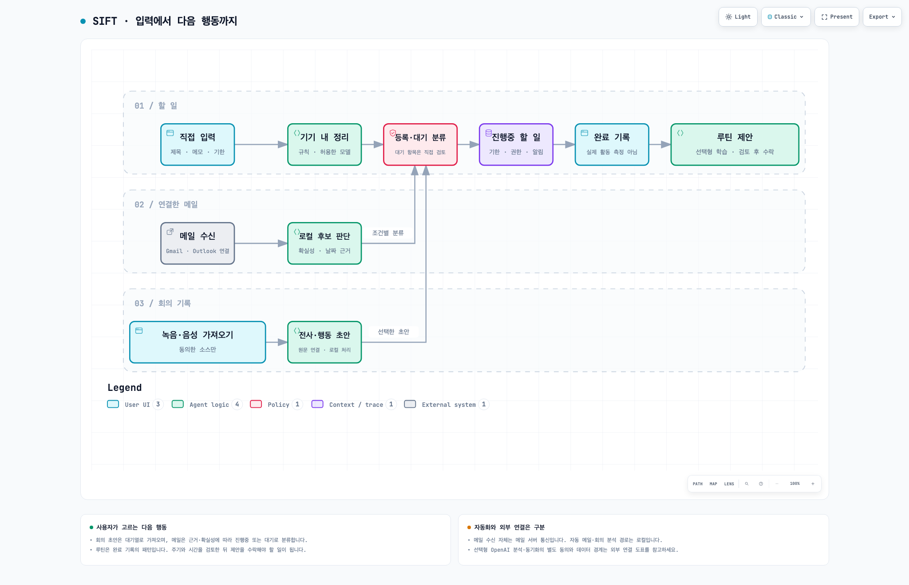

# SIFT

> 할 일을 직접 기록하고, 메일의 요청을 확인해 저장하며, 실제 마감부터 챙기는 iOS 중심 투두 앱

SIFT는 **기기 내 분석을 기본으로 하는 할 일 관리 앱**입니다. AI가 제안한 내용보다 원문과 사용자의 확인을 우선하며, 메일에 없는 마감일을 임의로 만들지 않습니다. 현재 개발 소스의 UI는 **한국어·영어·스페인어·일본어·중국어 간체·프랑스어·이탈리아어·독일어**를 지원합니다.

**[App Store에서 SIFT: To-Do List 무료 다운로드](https://apps.apple.com/kr/app/sift-to-do-list/id6782752844)**

소스 코드는 **[Apache License 2.0](LICENSE)**으로 제공합니다. 상업적 이용, 수정, 재배포와 비공개 파생 제품 개발이 가능합니다. 적용 조건과 제3자 구성요소의 경계는 아래 [라이선스](#라이선스)를 확인하세요.

## 다운로드와 개발 소스의 차이

현재 배포 대상은 **iOS/iPadOS 앱과 macOS용 Mac Catalyst 앱**입니다. 이번 `1.0.10 (6)` 후보는 iOS/iPadOS 26.0 이상과 macOS 26.0 이상을 대상으로 하며 Mac 패키지는 Apple Silicon·Intel 통합 바이너리입니다. Mac 경로는 별도의 네이티브 AppKit 제품이 아니며, 온디바이스 AI의 하드웨어·모델 지원 조건은 별도입니다. Android 소스가 저장소에 있지만 현재 배포 중인 Android 제품이나 iOS와 동등한 지원을 뜻하지 않습니다.

- **출시 앱**: App Store 소개·버전 기록에는 할 일 관리, 온디바이스 정리, 이메일·캘린더 연동, 회의 기록과 Laya 메일 분류·화자/후처리 기능이 안내되어 있습니다. 실제 설치 버전의 기능은 앱 화면과 스토어의 버전 기록을 기준으로 확인하세요.
- **2026-10-16 제출 상태**: iOS와 macOS의 `1.0.10 (6)` 모두 App Store Connect에서 **Waiting for Review**로 접수됐으며 승인 후 자동 출시하도록 설정했습니다. 공개 버전은 여전히 `1.0.9`이고, 심사 승인이나 새 버전 공개 완료를 주장하지 않습니다.
- **현재 개발 소스**: 아래 기능 설명은 이 저장소의 구현을 기준으로 합니다. 최근 완료 기록 기반 루틴, 승인 일정, 공식 ChatGPT 연결과 소스별 회의 기록 변경이 다운로드한 출시 바이너리에 모두 포함됐다고 주장하지 않습니다. 소스의 버전 번호나 빌드 성공만으로 배포 여부를 판단할 수 없습니다.
- **무료의 범위**: 앱 다운로드가 무료라는 뜻이지 ChatGPT 구독, 외부 제공자 사용량, 네트워크 비용이나 무제한 AI 요청이 포함된다는 뜻은 아닙니다. 선택형 제공자에는 해당 계정의 권한·모델 가용성·사용량 제한과 약관이 적용됩니다.

개발 변경과 검증 범위는 [변경사항](docs/changes.md), 기기별 확인 항목은 [UI 테스트 계획](ios/UI_TEST_PLAN.md)에 따로 기록합니다.

## 앱 미리보기와 현재 작업 흐름

[](docs/media.md)

[소개 이미지와 규격](docs/media.md) · [웹 갤러리](https://sift.pieroot.xyz/media.html) · [이미지 묶음 ZIP](docs/assets/media/sift-media-kit.zip)

한국어·영어 iPhone/iPad 스토어용 정적 이미지와 웹 미리보기를 제공합니다. 실제 QA 시뮬레이터 화면에 합성 예시 데이터를 사용했으며, App Preview 동영상이나 App Store 업로드 완료를 뜻하지 않습니다. 현재 출시 바이너리와 기능이 일치하는지 확인한 뒤 사용하세요.

[](docs/workflows.md)

[작업 흐름·회의 처리·데이터 경계 설명](docs/workflows.md) · [웹에서 도표 탐색](https://sift.pieroot.xyz/workflows.html) · [편집 가능한 도표 원본](docs/assets/workflows/overview.workflow.json)

메일은 조건에 따라 진행중 또는 등록 대기로 분류하고, 회의 초안·루틴 제안은 사용자 검토를 거칩니다. 완료 기록은 실제 활동의 측정값이 아닙니다. 도표는 개발 소스 기준이며 선택형 모델·외부 연결의 권한과 지원 조건을 생략한 출시 기능 목록이 아닙니다.

## 할 일을 다루는 방식

### 직접 입력하고 실제 마감부터 확인

제목·메모·선택적 마감으로 할 일을 직접 추가하고, 상세 화면에서 수정·완료할 수 있습니다. 진행중 목록은 **기한 초과를 포함한 실제 마감 순**으로 보여주며, 기한 없는 일은 뒤에 둡니다. AI 우선순위와 추천 처리 시각은 보조 정보이지 실제 마감이나 승인한 일정의 대체물이 아닙니다.

개발 소스의 목록은 실제 AI 분석에 성공한 항목에만 작은 반짝임 표시를 붙입니다. 규칙 처리·오류 후 대체 결과·미분석 항목에는 표시하지 않으며 상세 분석 근거는 유지합니다. 새 할 일의 추가 옵션은 스크롤로 접근하고, 키보드 닫기와 저장은 별도 동작입니다.

할 일 화면의 기본 도구 모음은 **추가 + 더 보기**입니다. **더 보기 → 설정 → 앱 언어**에서 8개 언어 또는 시스템 언어를 선택하며, 언어를 바꿔도 사용자가 적은 제목·메일·회의 원문은 번역하거나 덮어쓰지 않습니다. 음성 인식과 AI의 언어 지원·품질은 UI 번역과 별도이며 기기·모델의 실제 지원 조건을 따릅니다.

### 메일 원문을 보고 저장

메일 목록·상세의 **할 일로 저장**에서 발신자와 원본 제목을 확인하고, 제안된 제목·메모·기한을 수정한 뒤 저장합니다. 원문에서 기한을 찾지 못하면 **기한 없이 저장**합니다. 저장한 할 일에는 원본 메일 참조와 발신자 정보가 남습니다.

현재 메일 탭은 `MailboxProviderRegistry`를 통해 **Gmail IMAP·Outlook IMAP**을 사용합니다. Gmail은 앱 비밀번호 연결 경로이며, `EmailService`의 Gmail OAuth/REST 경로도 별도로 남아 있습니다. 읽음 처리·휴지통 이동은 연결한 원래 제공자의 서버에 반영하는 동작입니다. Outlook의 레거시 앱 비밀번호 인증은 서버 정책에 따라 거부될 수 있고, Microsoft 365의 기본 인증 차단을 우회하지 않습니다. [Outlook 연결 조건](docs/outlook-imap-setup.md)을 먼저 확인하세요.

자동 메일 분석을 켠 경우, 설치·활성화한 **Laya**가 할 일 후보를 추천하고 사용 가능한 **Apple Foundation Models**가 요약·정리 초안을 만듭니다. 지원·설치·허용 조건이 없거나 실패하면 로컬 날짜·요약 규칙을 사용합니다. Laya는 요약이나 날짜를 생성하는 모델이 아닙니다. 기한 없는 후보나 불확실한 자동 판단은 **등록 대기열**에 두며, 후보가 아니라고 판단된 메일도 사용자가 직접 확인해 저장할 수 있습니다.

### 캘린더 연동과 등록 대기열

시스템 캘린더는 **EventKit 권한과 사용자가 선택한 설정**에 따라 연결합니다.

- 현재 개발 소스의 시작/변경 동기화는 **캘린더 권한이 있으면 기한이 있는 진행중 할 일을 자동 등록**합니다. 이 경로는 설정의 자동 등록 토글을 검사하지 않습니다. 메일 저장 화면의 즉시 추가를 선택하지 않았어도 이후 동기화 대상이 될 수 있습니다. 등록 대기·외부 캘린더 출처는 아래 제외 규칙을 따릅니다.
- 외부 캘린더의 향후 30일 일정을 등록 대기열로 가져옵니다. 주간 가져오기에는 7일 쿨다운이 있으며, 앱이 만든 일정의 역가져오기·중복 등록을 구분합니다.
- **등록 대기(`.review`) 항목은 일괄 AI 정렬·알림·자동 캘린더 등록에서 제외**합니다. 외부 캘린더 출처의 할 일을 새 일정으로 다시 자동 등록하지 않습니다.
- 반복 일정에는 가까운 발생분을 진행중으로 승격하는 정책이 있습니다. 완료 시 일정 삭제/알람 해제는 설정과 원본 일정의 소유권에 따라 처리하며, 외부 원본을 앱이 만든 일정처럼 취급하지 않습니다.

### 완료 기록 기반 루틴과 승인 일정 — 개발 소스

루틴 학습은 **사용자가 켜고 직접 분석하는 선택 기능**입니다. 최근 90일의 완료된 수동 할 일을 동일한 정규화 제목으로 묶고 최소 3일의 완료 근거를 요구합니다. 메일·회의·외부 캘린더·등록 대기·삭제 항목은 학습 근거에서 제외합니다.

**완료 체크 시각은 실제 복약·운동·수면 시각이나 건강 상태의 증거가 아닙니다.** 사용자가 근거·신뢰도·불확실성을 보고 활동·주기·선호 시간·예상 소요 시간을 수정·확정한 루틴에서만 새 할 일을 제안합니다. 제안에는 수락·거절·미루기로 응답할 수 있고 같은 발생분의 중복 생성을 막습니다.

일정 검토는 가용 시간·실제 마감·확정 작업·권한이 있는 캘린더 충돌·시간대/DST를 검사합니다. 적합한 공간이 없으면 일정을 만들지 않으며, **검토한 구간을 승인해야 실제 시작일·마감일이 저장**됩니다. 캘린더를 확인할 수 없을 때는 그 한계를 별도로 확인해야 합니다. 시작 알림과 캘린더 내보내기는 각각 선택합니다.

루틴·근거·피드백·예약 저널은 파일 보호와 백업 제외를 적용한 로컬 JSON에 보관합니다. 학습 끄기는 분석·제안을 중단하고, 모두 삭제는 학습 기록을 지웁니다. 이미 승인한 할 일은 별도로 관리·삭제해야 합니다.

## AI와 회의 베타

### 온디바이스 제공자

Apple Foundation Models는 기기·언어·Apple Intelligence 활성 상태가 맞아야 사용할 수 있습니다. MLX의 선택 가능한 로컬 모델과 Laya 등 별도 모델 경로에도 각각의 지원·설치·베타 허용 조건이 적용됩니다. 베타를 켜는 것과 모델을 내려받는 것은 별개이며, 설치는 사용자가 명시적으로 시작합니다.

**Laya는 아직 품질 기준을 충족하지 못한 베타**입니다. 고정 Core ML 모델의 균형 EN/KO 48개 평가에서 기존 choice 질문은 35/48, 새 score 질문의 이진 proxy는 32/48이었고, 언어별 정확도 ≥80%·클래스별 재현율 ≥70% 기준에 미달했습니다. 내부 `isDecisive` 조건은 정답 확률이나 오류 감소 보장이 아니며, 이 평가는 메일 분류 품질·실기기 성능 증거가 아닙니다. 결과를 검토해 사용하세요. 재현 코드는 [평가 스크립트](scripts/evaluate_laya_priority.py)와 [평가 의존성](scripts/laya-eval-requirements.txt)에 있습니다. [이전 export 보고서](scripts/laya_export_report.md)의 영어 전용 모델 수치는 현재 다국어 모델의 성능으로 해석하면 안 됩니다.

### 회의 녹음·전사·화자 구분

녹음에는 참가자의 동의와 필요한 시스템 권한이 있어야 합니다. 권한 안내·허용만으로 녹음이나 모델 다운로드를 시작하지 않습니다. 권한을 거부해도 기본 할 일 관리는 계속할 수 있습니다.

현재 개발 소스는 새 회의를 **부모 회의와 소스별 독립 자식 기록**으로 보관합니다. 각 트랙이 원음 FLAC·전사·화자 결과를 소유하고, 트랙별 재생·내보내기·재처리·편집을 제공합니다. 부모에 혼합 오디오나 합친 전사문을 만들지 않으며, 기존 완료 기록은 자동 변환하지 않습니다. 한 트랙의 실패가 다른 트랙의 원음·전사를 지우지 않도록 처리합니다.

- **화자 구분**: Nemotron 베타 활성화와 전체 모델 팩 설치가 필요합니다. Community-1 FBank/WeSpeaker는 같은 트랙의 라이브·최종 ID 연결을 돕는 보조 모델입니다. 음성 임베딩은 분석 중 메모리에만 두고 저장·동기화하거나 다른 트랙/회의의 사람을 연결하지 않습니다.
- **오프라인 고급 전사**: WhisperKit 모델을 별도로 설치·활성화한 뒤 종료 후 처리하거나 기존 기록에서 직접 재전사합니다. 원음과 Apple 원문을 보존하며 설치만으로 기존 기록을 자동 재작성하지 않습니다.
- **로컬 오디오 가져오기**: 회의 화면의 가져오기에서 파일과 지원 언어를 선택합니다. 앱의 8개 언어 태그를 Whisper 언어에 연결하되 실제 인식 품질을 보장하지 않습니다. 지원 오디오를 최대 6시간까지 로컬 FLAC으로 복사한 뒤 설치된 Whisper와 기존 후처리 경로를 사용합니다. 원본 파일은 바꾸지 않으며, 모델 미설치·전사 실패 시에도 가져온 음성은 다시 시도할 수 있도록 보존합니다. 파일 선택은 마이크 권한·모델 다운로드를 시작하지 않습니다.
- **진행 상태와 긴 파형**: 모델 준비·음성 준비·인식/시간 정렬·검사/저장을 구분하고 실제 처리된 음성 위치·경과 시간을 표시합니다. 충분한 인식 진행 후에만 현재 속도 기반 예상 잔여 시간/완료 시각을 표시하며 후속 화자 분석·검수·요약 시간은 제외합니다. 긴 파형은 약 0.1초 구간을 유지하고 세밀한 드래그와 전체 탐색 슬라이더를 제공합니다.
- **앱 오디오 경계**: iOS 27 iPhone은 시스템에서 승인한 단일 전체 화면 출력과 마이크 경로입니다. 개별 앱·참가자 선택이 아니며 iOS 26.x와 시뮬레이터에서는 앱 오디오를 지원하지 않습니다. Catalyst에는 각각 승인한 최대 4개 대상과 별도 마이크 경로가 있습니다. Teams/Meet/Zoom/Discord 직접 수신기를 구현한 것은 아닙니다.
- **검증 한계**: 실제 다중 소스 통화 수집, 한국어 다화자 정확도, 물리 iPhone의 라이브 지연·장시간 발열은 검증 완료로 주장하지 않습니다. iPhone 모델 로딩 지연도 보고되어 있습니다. 소스 on/off는 다른 앱의 송신 음소거가 아니며 스피커 재유입도 제거하지 못하므로 헤드폰을 권장합니다.

모델 출처·설치 크기·실행 근거·오류 진단과 남은 하드웨어 검증은 [회의 마일스톤](docs/meeting-milestones.md), [회의 UI 확인 항목](ios/UI_TEST_PLAN.md#meeting-source-controls-and-offline-asr)에 정리되어 있습니다. 회의 음성·전사·화자 정보는 OpenAI에 보내지 않습니다.

### 선택형 ChatGPT 연결 — 개발 소스

OpenAI는 **온디바이스 모델이 아니라 실제 원격 요청을 보내는 선택형 제공자**입니다. 베타 제공자 활성화, 공식 **Continue with ChatGPT** 연결, 계정의 사용 권한과 **할 일·메일·루틴·페르소나별 독립 공유 동의**가 필요합니다. 로그인 자체는 데이터 전송 동의가 아닙니다.

일반 할 일 정렬은 허용한 데이터 범위만 전송합니다. 메일·회의 출처의 자동 분석·정렬은 로컬에 남고, 선택한 메일의 제목·본문은 이메일 공유 동의 후 사용자가 해당 요청을 직접 실행할 때만 전송합니다. 별도 캘린더 이벤트 컨텍스트는 제목을 `Busy`로 가리고 시간 구간만 사용합니다. 다만 외부 캘린더에서 가져와 진행중으로 확정한 할 일은 일반 할 일 공유 동의 범위에 포함되어 제목·메모가 전송될 수 있습니다. 설명 초안은 원문·페르소나·로컬 통계를 자동으로 덮어쓰지 않습니다.

현재 소스의 기본 모델은 `gpt-6-luna`, 사용자가 직접 선택하는 고급 재요청은 `gpt-6.1-sol`입니다. 계정 모델 목록에서 지정 모델을 사용할 수 없으면 오류를 표시하며 다른 모델로 자동 대체하지 않습니다. Responses API의 `store:false`는 제공자 측 무보존을 보장하지 않습니다. 동의 철회·제공자 해제·계정 전환·로그아웃은 관련 요청과 늦은 결과의 적용을 취소합니다. 연결 자격증명은 동기화하지 않는 기기 전용 Keychain에 보관합니다.

개인 계정 연결은 **설정 → OpenAI · ChatGPT → ChatGPT로 계속하기**에서 시작합니다. 계정 로그인과 OpenAI의 구독 사용 권한 승인을 완료하고 제공자를 활성화한 뒤 **구독 연결 테스트**를 직접 누르면, 현재 계정의 모델 목록과 실제 완료 응답을 확인합니다. 이 테스트는 짧고 고정된 메시지만 보내며 저장된 할 일·메일·루틴·페르소나나 해당 범위의 공유 동의를 사용하지 않습니다. 계정의 구독 한도는 일부 소모할 수 있습니다. 실제 앱 데이터 분석에는 각 범위의 별도 동의가 계속 필요합니다.

공식 Swift SDK가 제공되지 않아 iOS의 `URLSession`으로 [공식 OAuth·Responses 계약](https://developers.openai.com/siwc/token-sharing-open-source/models-and-inference)을 호출합니다. SDK 설치 자체가 개인 구독 권한을 부여하지는 않습니다. 현재 경로는 OSS/로컬용 동적 등록이며, 추후 배포 승인은 서버가 부여하는 클라이언트·scope·계정 정책을 따라야 합니다. 승인 상태를 로컬 플래그로 꾸미거나 다른 제품의 client ID·토큰, 비공식 ChatGPT endpoint로 우회하지 않습니다.

**실제 ChatGPT 계정의 로그인 완료·구독 기반 추론, 물리 기기의 브라우저 콜백 상호운용성, 무제한 사용은 검증하지 않았습니다.** [공식 SIWC 문서](https://developers.openai.com/siwc/token-sharing-open-source)의 공개 소스·로컬 호스트 범위를 따르며, 유료 또는 원격 호스트 배포에는 별도 OpenAI 승인이 필요합니다. Apache 라이선스는 이러한 제공자 승인을 대신하지 않습니다.

## 데이터가 기기 밖으로 나가는 경우

**기본 AI 분석이 로컬이라는 것과 앱의 모든 기능이 오프라인이라는 것은 다릅니다.** 로컬 할 일 관리는 네트워크 없이 사용할 수 있지만 계정 연결·메일 조회·모델 설치·선택형 동기화·OpenAI 요청은 네트워크를 사용합니다.

| 경로 | 처리·전송 범위 |
|---|---|
| 기본 할 일·자동 메일 분석 | SwiftData, 지원되는 온디바이스 모델과 로컬 규칙. 기본 분석을 위해 메일 본문을 외부 AI에 보내지 않음 |
| Gmail·Outlook 연결 | 해당 제공자로 인증·메일 조회 및 사용자가 실행한 읽음/휴지통 변경 요청 전송. Gmail OAuth 경로는 `gmail.modify` 권한을 요청 |
| 시스템 캘린더 | EventKit을 통한 읽기·쓰기. 선택한 캘린더가 iCloud/Google/회사 계정이면 OS·계정의 동기화 정책이 적용됨 |
| iCloud 동기화 — 선택 | 할 일·페르소나·행동/Audit 기록·분석 결과를 CloudKit 비공개 DB로, 일부 설정을 KVS로 동기화. 이메일 본문 전용 저장소·회의 원본 기록·루틴 파일은 대상 아님 |
| Firebase 수동 동기화 — 선택 | 사용자가 업로드/다운로드하는 암호화 스냅샷. Google/Firebase 인증과 Firestore를 사용하며 비밀번호가 필요함. 할 일·페르소나·행동/Audit·분석 결과 대상; 이메일 전용 저장소·회의 원본·루틴 파일·OpenAI 자격증명은 제외 |
| 모델 설치 | 모델 호스트에서 파일 다운로드. 다운로드에 할 일·메일 원문을 첨부하지 않음 |
| OpenAI — 선택 | 별도 동의·요청 범위의 원격 분석. 계정·등록 인증 통신도 필요하며 제공자 정책과 사용량 제한 적용 |
| 오류 보고서 — 선택 | 로컬 수집 동의와 별도로 준비된 보고서를 검토·승인한 뒤 시스템 공유. 자동 외부 업로드 아님 |

**저장한 할 일의 제목·메모에 메일이나 회의에서 가져온 내용이 있으면 그 할 일의 동기화 정책은 적용됩니다.** 원본 전용 저장소의 제외가 파생한 모든 텍스트의 제외를 뜻하지 않습니다. 일반 이메일 OAuth 자격증명에는 iCloud 설정에 따른 Keychain 정책이 적용될 수 있지만, IMAP 앱 비밀번호와 OpenAI 자격증명은 동기화하지 않는 기기 전용 Keychain에 저장합니다. 자세한 항목·보관·삭제 범위는 [개인정보 처리방침](docs/privacy-policy.md)을 확인하세요.

## 소스 구조

| 경로 | 역할 |
|---|---|
| [`ios/todo.xcodeproj`](ios/todo.xcodeproj) | 현재 제품의 Xcode 프로젝트와 공유 `todo`·`todo-QA` 스킴 |
| [`ios/todo/Views`](ios/todo/Views) | SwiftUI 할 일·메일·회의·설정·검토 화면 |
| [`ios/todo/Models`](ios/todo/Models) | 할 일·페르소나·행동 기록·회의 등 데이터 모델 |
| [`ios/todo/Services`](ios/todo/Services) | 저장소, IMAP/OAuth, EventKit, 온디바이스/선택형 OpenAI, 루틴·회의 처리 |
| [`ios/todoTests`](ios/todoTests) / [`ios/todoUITests`](ios/todoUITests) | 정책·저장소 단위 테스트와 사용자 흐름 UI 테스트 |
| [`android`](android) | 미출시 Android 구현 소스. 현재 지원·배포 제품 아님 |
| [`backend/meeting-api`](backend/meeting-api) | 별도 회의 API 구현/참고 코드. 기본 iOS 로컬 할 일·회의 처리에 서버 운영이 필요한 것은 아님 |
| [`meeting-fixtures`](meeting-fixtures) / [`scripts`](scripts) | 공유 형식 fixture, 모델 변환·평가·재현 도구 |
| [`docs`](docs) | 제품 사이트, 약관·개인정보·변경사항·회의 검증 기록 |
| [`ci_scripts`](ci_scripts) | Xcode Cloud 사전 빌드 준비 |

메일 목록·본문 저장소는 주 앱 저장소와 분리되어 있고, 메일 provider 계약으로 IMAP 경로를 연결합니다. 일정은 `CalendarService`, AI 라우팅은 각 제공자와 베타 정책, 루틴·회의는 전용 로컬 저장소가 담당합니다. `EmailService = Gmail REST만 사용하는 전체 메일 아키텍처`로 해석하면 현재 구현과 맞지 않습니다.

## iOS 개발 시작

### Xcode에서 열기

1. 저장소 루트에서 `open ios/todo.xcodeproj`를 실행합니다.
2. Swift Package 의존성 해석을 기다립니다. 실제 고정 버전은 [`Package.resolved`](ios/todo.xcodeproj/project.xcworkspace/xcshareddata/swiftpm/Package.resolved)와 프로젝트의 패키지 요구사항을 기준으로 합니다. 모델 가중치는 패키지 해석과 별도의 설치 대상입니다.
3. **`todo-QA` 스킴**과 설치된 iPhone/iPad 시뮬레이터를 선택해 실행합니다.
4. 물리 기기에서는 자신의 Apple Developer 팀·서명·고유 번들 ID·iCloud 컨테이너를 설정합니다. 저장소의 배포용 팀과 서비스 구성이 재사용 권한을 주는 것은 아닙니다.

현재 앱 대상의 iOS deployment target은 **26.0**, 단위 테스트 대상은 **26.5**입니다. 최근 개발·QA 기록은 **Xcode 27**을 사용합니다. 이것을 모든 이전 Xcode 버전의 호환성 보장으로 해석하지 마세요. Apple Intelligence, 앱 오디오와 모델별 기능에는 추가 OS·기기 조건이 있습니다.

### 시뮬레이터 빌드·실행·테스트

다음은 저장소 루트에서 사용하는 명령 예시입니다. `SIMULATOR_UDID`는 `xcrun simctl list devices available`에서 선택한 **iOS 26.5 이상** 시뮬레이터 ID로 바꾸세요.

```sh
xcrun simctl list devices available
SIMULATOR_UDID='YOUR_SIMULATOR_UDID'
xcrun simctl bootstatus "$SIMULATOR_UDID" -b

xcodebuild -project ios/todo.xcodeproj -scheme todo-QA -configuration Debug-QA \
  -destination "platform=iOS Simulator,id=$SIMULATOR_UDID" \
  -derivedDataPath ios/.xcode-derived-data/todo CODE_SIGNING_ALLOWED=NO build

xcrun simctl install "$SIMULATOR_UDID" \
  ios/.xcode-derived-data/todo/Build/Products/Debug-QA-iphonesimulator/todo.app
xcrun simctl launch "$SIMULATOR_UDID" pieroot.sift-todo.qa

# 단위 테스트
xcodebuild -project ios/todo.xcodeproj -scheme todo-QA -configuration Debug-QA \
  -destination "platform=iOS Simulator,id=$SIMULATOR_UDID" \
  -derivedDataPath ios/.xcode-derived-data/todo CODE_SIGNING_ALLOWED=NO \
  -only-testing:todoTests test

# UI 테스트
xcodebuild -project ios/todo.xcodeproj -scheme todo-QA -configuration Debug-QA \
  -destination "platform=iOS Simulator,id=$SIMULATOR_UDID" \
  -derivedDataPath ios/.xcode-derived-data/todo CODE_SIGNING_ALLOWED=NO \
  -only-testing:todoUITests test
```

UI 테스트는 격리된 in-memory SwiftData와 합성 fixture를 사용합니다. 성공해도 실제 메일 계정·iCloud·오디오 품질이나 재시작 후 디스크 보존의 증거가 아닙니다. Mac Catalyst는 빌드·실행 확인과 별도 네이티브 검증 대상으로, 시뮬레이터의 XCUIAutomation 입력 합성을 그대로 지원하지 않습니다.

### QA와 출시 앱의 서명·데이터 분리

| 목적 | 공유 스킴 / 구성 | 저장소 기본 앱 ID |
|---|---|---|
| 실행·단위/UI 테스트 | `todo` 또는 `todo-QA`의 Run/Test → `Debug-QA` | `pieroot.sift-todo.qa` |
| QA 프로파일·아카이브 | `todo-QA` → `Release-QA` | `pieroot.sift-todo.qa` |
| 출시 아카이브 | `todo`의 Archive → `Release` | `pieroot.sift-todo` |

QA는 앱 데이터 컨테이너·Keychain 그룹·iCloud KVS/CloudKit 컨테이너(`iCloud.pieroot.sift-todo.qa`)를 분리하고, Firebase 스냅샷도 `snapshot-qa` 문서를 사용합니다. 출시 경로는 `snapshot`입니다. **QA 설치 명령에 `-configuration Debug` 또는 `Release`를 넘기면 출시 앱 ID로 빌드**되므로 QA 구성을 명시하세요. 로컬 개인 스킴이 아니라 저장소의 공유 스킴을 사용합니다. 자체 fork는 두 ID와 연동 컨테이너를 자신의 것으로 함께 변경해야 합니다.

서명·기기 등록·QA iCloud 컨테이너 프로비저닝 권한이 준비된 경우:

```sh
DEVICE_UDID='YOUR_DEVICE_UDID'
xcodebuild -project ios/todo.xcodeproj -scheme todo-QA -configuration Debug-QA \
  -destination "platform=iOS,id=$DEVICE_UDID" \
  -derivedDataPath ios/.xcode-derived-data/todo \
  -allowProvisioningUpdates -allowProvisioningDeviceRegistration build
xcrun devicectl device install app --device "$DEVICE_UDID" \
  ios/.xcode-derived-data/todo/Build/Products/Debug-QA-iphoneos/todo.app
xcrun devicectl device process launch --device "$DEVICE_UDID" pieroot.sift-todo.qa
```

개발 서명 앱의 동시 설치 기록을 실제 App Store 바이너리와의 공존·실시간 iCloud 동기화 검증으로 확대하지 않습니다. 출시 배포 전에는 아카이브의 실제 번들 ID·서명·기능 반영을 별도로 확인해야 합니다.

### Gmail QA 제한과 서비스 설정

QA 앱은 출시 Gmail OAuth 콜백 URL 스킴을 등록하지 않습니다. 별도 Google iOS 클라이언트가 없는 현재 QA REST 로그인은 설정 필요 오류를 냅니다. **같은 콜백 스킴을 두 앱에 중복 등록하지 마세요.** QA Gmail IMAP 앱 비밀번호 경로는 이 OAuth 제한과 별개입니다.

QA OAuth를 사용할 때는 [Google iOS OAuth 클라이언트 지침](https://developers.google.com/identity/protocols/oauth2/native-app#creatingcred)에 따라 자신의 QA 번들 ID용 클라이언트를 만들고 `EmailService.swift`의 QA 인증 경로와 `InfoQA.plist`의 전용 리디렉트·URL 스킴을 함께 설정해야 합니다. Firebase 수동 동기화도 자신의 프로젝트 설정과 보안 규칙·Google 인증 구성이 필요합니다. 제공자의 자격증명이나 개발자의 운영 서비스 사용 권한은 소스 라이선스에 포함되지 않습니다.

### iCloud 권한 없는 로컬 전용 검증 빌드

CloudKit·iCloud KVS entitlement를 제외한 별도 빌드에서는 기존 조건을 보존해 **`SWIFT_ACTIVE_COMPILATION_CONDITIONS = $(inherited) SIFT_LOCAL_ONLY`**를 추가해야 합니다. 이 조건은 CloudKit/KVS 접근·동기화 대기·iCloud 활성화 UI를 차단하고 새 공통 Keychain 저장을 기기 전용으로 처리합니다. 일반 QA·출시 구성에는 추가하지 않습니다.

**기존 iCloud 원설정을 강제로 끄지 마세요.** 로컬 전용 빌드도 원설정이 켜져 있으면 기존 `icloud_v2.store`를 CloudKit 없이 열어 데이터를 보존합니다. 빈 `local_v2.store`로 전환해 기존 데이터를 숨기는 방식은 사용하지 않습니다. 이 조건은 메일·모델 다운로드·Firebase·OpenAI까지 막는 전체 네트워크 차단 스위치가 아닙니다.

## 문서와 검증 범위

| 문서 | 내용 |
|---|---|
| [앱 소개 이미지](docs/media.md) · [웹](https://sift.pieroot.xyz/media.html) | 한국어·영어 iPhone/iPad 스토어 이미지, 웹 미리보기와 원본 캡처 |
| [작업 흐름](docs/workflows.md) · [웹](https://sift.pieroot.xyz/workflows.html) | 현재 할 일·메일·회의·루틴 흐름과 로컬/선택형 외부 데이터 경계 |
| [변경사항](docs/changes.md) · [웹](https://sift.pieroot.xyz/changes.html) | 기능 변경, 배포/아카이브와 실제 검증의 구분 |
| [개인정보 처리방침](docs/privacy-policy.md) · [웹](https://sift.pieroot.xyz/privacy-policy.html) | 선택형 전송·동기화, 보관·삭제, 제공자 정책 |
| [서비스 약관](docs/terms-of-service.md) · [웹](https://sift.pieroot.xyz/terms-of-service.html) | 앱·서비스 이용 조건; 소스 라이선스와 구분 |
| [UI 테스트 계획](ios/UI_TEST_PLAN.md) | 재현 흐름, QA 격리, 기기/시뮬레이터 한계와 진단 기록 |
| [회의 마일스톤](docs/meeting-milestones.md) | 음성 원본·모델 귀속·소스 캡처 경계·미검증 품질 |
| [Outlook IMAP 설정](docs/outlook-imap-setup.md) | 레거시 인증의 실제 제한 |
| [국제화 정책](docs/i18n-policy.md) | 8개 언어, 시스템/수동 선택, 원문 보존과 모델 언어 지원 경계 |

테스트 통과·합성 UI·작은 실제 모델 샘플은 출시 완료, 실제 계정 연결, 한국어 정확도나 모든 하드웨어의 성능 보장이 아닙니다. 오래된 모델·기기에서 측정한 지연 수치를 현재 모델이나 iPhone 성능으로 인용하지 않습니다. 진단 보고서는 공유 전에 로컬에서 내용을 검토·승인하며, 취소하면 외부 공유 없이 로컬 기록을 유지합니다.

## 라이선스

SIFT의 자체 코드에 적용되는 조건은 **[Apache License 2.0](LICENSE)**과 **[NOTICE](NOTICE)**를 기준으로 합니다.

- **허용**: 개인·상업적 이용, 수정, 복제, 재배포, 유료 제품 개발과 **소스를 공개하지 않는 파생 제품**. Apache-2.0은 파생 코드 전체의 공개를 요구하지 않습니다.
- **재배포 의무**: 수령자에게 라이선스 사본을 제공하고, 수정한 파일에는 변경 사실을 알리는 눈에 띄는 고지를 남기며, 적용되는 저작권·특허·상표·귀속 고지를 보존합니다. NOTICE의 관련 귀속 고지도 라이선스가 정한 방법으로 함께 전달해야 합니다. 전체 조건은 LICENSE 원문이 우선합니다.
- **제3자 구성요소**: 외부 라이브러리·SDK·모델 가중치·토크나이저·이미지·아이콘 등은 각자의 라이선스를 따르며 이 저장소의 Apache 선언으로 재라이선스되지 않습니다. 예를 들어 고정 Community-1 변환 FBank/Embedding 자산의 [CC BY 4.0 범위와 NOTICE](https://huggingface.co/FluidInference/speaker-diarization-coreml/blob/df2625ac79a7ac6b65ad868fee6d80f320da4232/NOTICE.md)는 별도로 적용됩니다(Nemotron 전체에 적용되는 선언이 아님). pyannote·WeSpeaker·BUT Speech@FIT·Fluid Inference 귀속과 Core ML 변환 고지는 [루트 NOTICE](NOTICE)를 함께 확인하세요. 모델 다운로드·재배포 시에도 각 원출처의 조건을 확인해야 합니다.
- **앱에 포함되는 고지**: 현재 소스는 고정된 SDK·내장 라이브러리의 라이선스 전문과 귀속을 [ThirdPartyNotices.txt](ios/todo/ThirdPartyNotices.txt)에 함께 포함합니다. 설정 → 앱 정보 → 오픈소스 라이선스에서 구성요소별로 열람할 수 있습니다. 의존성 버전을 바꾸면 해당 원출처의 전문·고지를 갱신해야 합니다. 이 고지 파일에 모델 가중치가 포함되거나 외부 구성요소가 Apache-2.0으로 바뀌는 것은 아닙니다.
- **포함되지 않는 권한**: SIFT 이름·로고의 상표권이나 공식 제품으로 오인시키는 권리, 개발자의 서명·App Store 계정·OAuth/Firebase 프로젝트·운영 서비스·제공자 자격증명은 이전되지 않습니다. 외부 서비스 승인·구독·요금·약관도 별도입니다.
- **보증 없음**: 소스는 라이선스에 따라 현 상태로 제공됩니다. 재사용하는 제품의 보안·개인정보·배포 정책과 제공자 조건은 배포자가 확인해야 합니다.

라이선스 부여와 GitHub 저장소의 공개/비공개 설정은 별개의 사항이며, 이 문서는 저장소 공개 설정이 변경됐다는 확인이 아닙니다.
