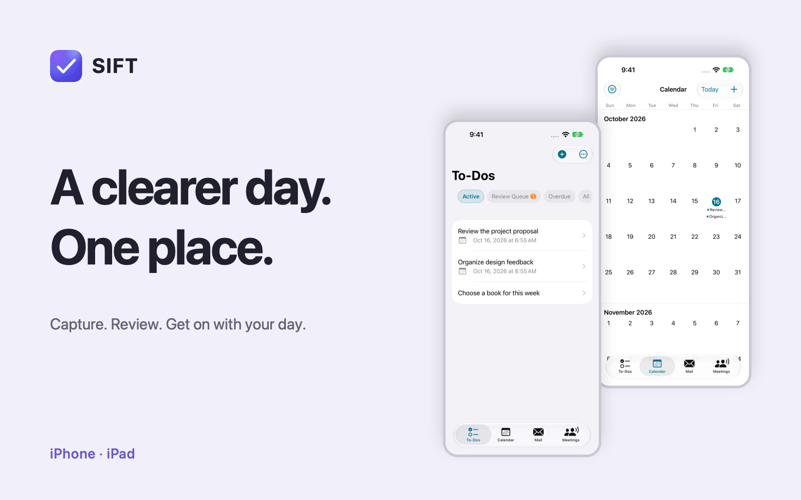
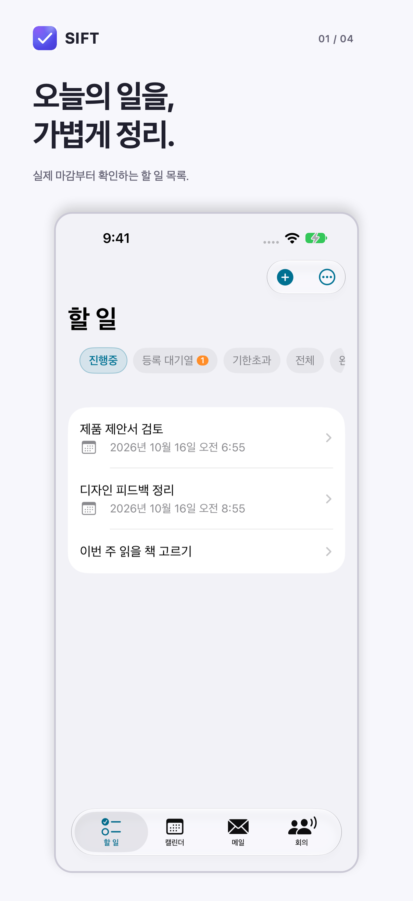
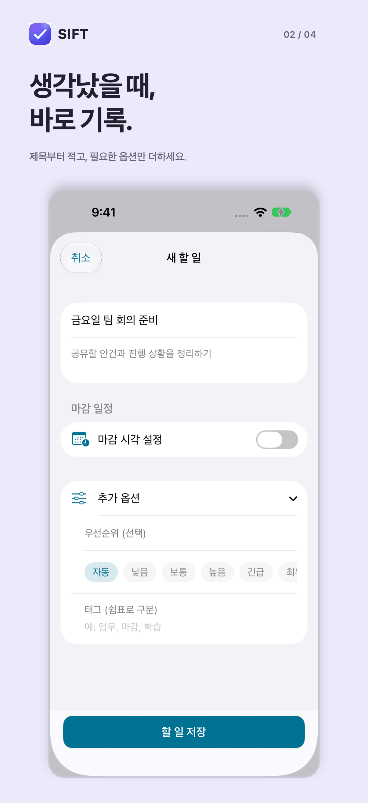
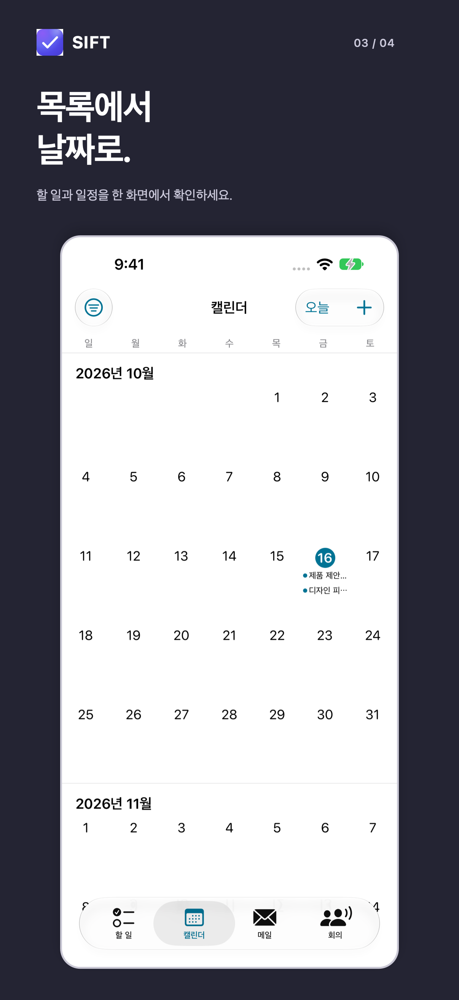
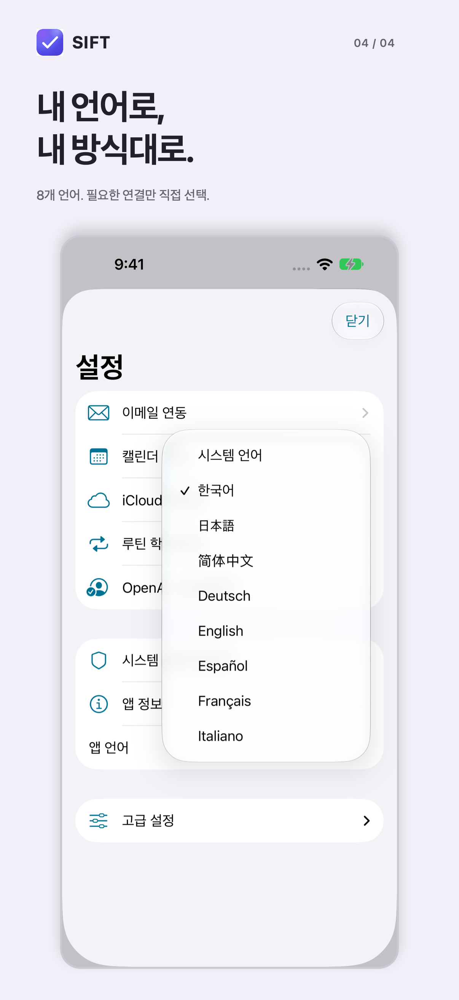
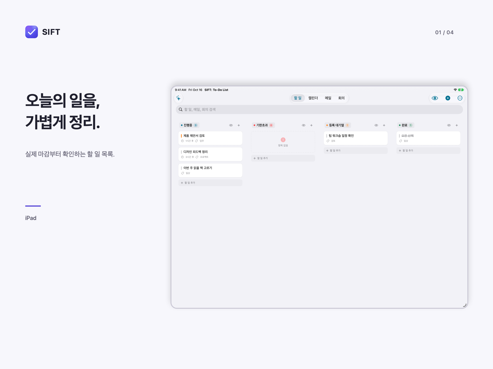
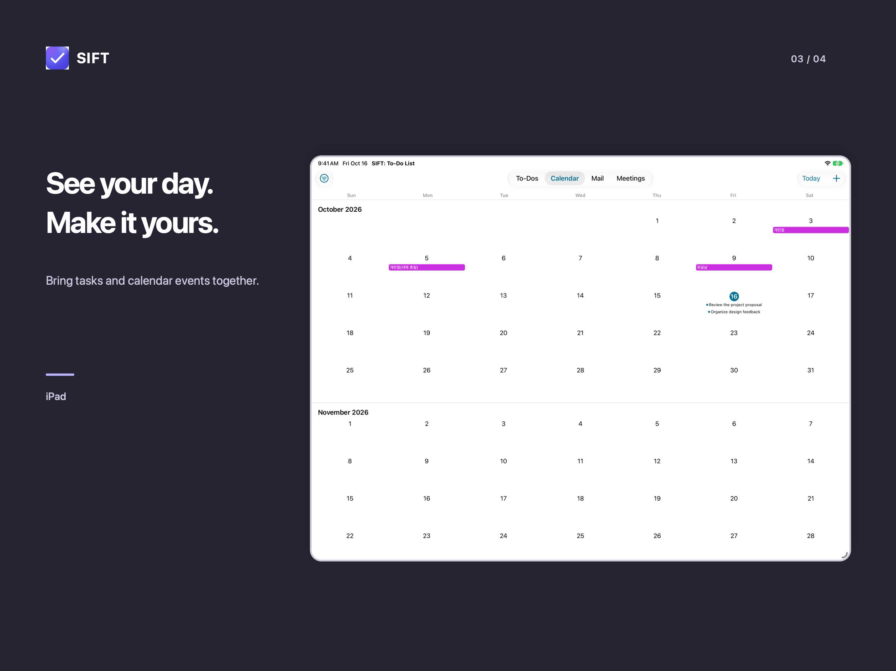

<link rel="stylesheet" href="assets/css/media.css">

# SIFT를 소개하는 이미지

할 일을 기록하고, 마감을 확인하고, 날짜별로 살펴보는 화면. **실행한 앱의 네이티브 캡처**에 SIFT의 색과 짧은 설명을 더했습니다. 앱 UI를 이미지 생성 모델로 그리거나, 실행하지 않은 AI 분석 결과를 합성하지 않았습니다.

> **개발 버전 · 예시 데이터** — 2026년 10월 16일 개발 소스의 iOS Simulator 화면입니다. 화면에 보이는 할 일은 소개용 샘플이며 실제 개인·메일·회의 데이터가 아닙니다. 배포 버전과 일치하는지 확인한 뒤 App Store에 올리세요. 여기서 제공하는 것은 **정적 스크린샷과 미리보기 이미지**이며, Apple의 동영상 형식인 **App Preview**가 아닙니다. 이미지 업로드나 앱 배포는 별도입니다.

[전체 이미지 ZIP 다운로드](assets/media/sift-media-kit.zip) · [파일 크기·언어·출처 명세](assets/media/manifest.json) · [네이티브 캡처 출처](assets/media/captures/manifest.json)

한국어·영어 각각 iPhone 4장, iPad 4장, 웹 미리보기 1장, 공유 카드 1장으로 **완성 이미지 20장**입니다. ZIP에는 실제 네이티브 캡처 16장과 두 명세 파일도 포함됩니다.

## 웹 미리보기

<div class="media-previews">
  <figure><a href="assets/media/ko/web-preview.png"></a><figcaption>한국어 · 1600×1000</figcaption></figure>
  <figure><a href="assets/media/en/web-preview.png"></a><figcaption>English · 1600×1000</figcaption></figure>
</div>

공유 카드용 1200×630: [한국어 PNG](assets/media/ko/social-preview.png) · [English PNG](assets/media/en/social-preview.png). 웹 미리보기와 공유 카드는 App Store 제출용 크기가 아닙니다.

## iPhone용 App Store 이미지

1206×2622 픽셀, 불투명 RGB PNG. Apple이 안내하는 **Dynamic Island 중간 디스플레이** 세로 스크린샷 크기입니다. 네 장을 번호순으로 사용할 수 있습니다.

<div class="media-phone-grid">
  <figure><a href="assets/media/ko/iphone-01-tasks.png"></a><figcaption>01 · 할 일</figcaption></figure>
  <figure><a href="assets/media/ko/iphone-02-capture.png"></a><figcaption>02 · 빠른 기록</figcaption></figure>
  <figure><a href="assets/media/ko/iphone-03-calendar.png"></a><figcaption>03 · 캘린더</figcaption></figure>
  <figure><a href="assets/media/ko/iphone-04-languages.png"></a><figcaption>04 · 언어와 설정</figcaption></figure>
</div>

| 순서 | 한국어 원본 | English original |
|---|---|---|
| 01 · 할 일 | [PNG 다운로드](assets/media/ko/iphone-01-tasks.png) | [Download PNG](assets/media/en/iphone-01-tasks.png) |
| 02 · 빠른 기록 | [PNG 다운로드](assets/media/ko/iphone-02-capture.png) | [Download PNG](assets/media/en/iphone-02-capture.png) |
| 03 · 캘린더 | [PNG 다운로드](assets/media/ko/iphone-03-calendar.png) | [Download PNG](assets/media/en/iphone-03-calendar.png) |
| 04 · 언어와 설정 | [PNG 다운로드](assets/media/ko/iphone-04-languages.png) | [Download PNG](assets/media/en/iphone-04-languages.png) |

## iPad용 App Store 이미지

2732×2048 픽셀, 불투명 RGB PNG. Apple이 허용하는 **13인치 iPad** 가로 스크린샷 크기입니다. iPhone 화면을 늘린 것이 아니라 iPad에서 직접 캡처한 화면을 사용합니다.

<div class="media-previews">
  <figure><a href="assets/media/ko/ipad-01-tasks.png"></a><figcaption>iPad · 할 일 보드</figcaption></figure>
  <figure><a href="assets/media/en/ipad-03-calendar.png"></a><figcaption>iPad · Calendar</figcaption></figure>
</div>

| 순서 | 한국어 원본 | English original |
|---|---|---|
| 01 · 할 일 | [PNG 다운로드](assets/media/ko/ipad-01-tasks.png) | [Download PNG](assets/media/en/ipad-01-tasks.png) |
| 02 · 빠른 기록 | [PNG 다운로드](assets/media/ko/ipad-02-capture.png) | [Download PNG](assets/media/en/ipad-02-capture.png) |
| 03 · 캘린더 | [PNG 다운로드](assets/media/ko/ipad-03-calendar.png) | [Download PNG](assets/media/en/ipad-03-calendar.png) |
| 04 · 언어와 설정 | [PNG 다운로드](assets/media/ko/ipad-04-languages.png) | [Download PNG](assets/media/en/ipad-04-languages.png) |

## 업로드 전 확인

- 소개 이미지 문구와 UI는 한국어·영어 두 세트입니다. **앱 자체의 언어는 한국어·영어·스페인어·일본어·중국어 간체·프랑스어·이탈리아어·독일어, 총 8개**이며, 사용자 원문은 자동 번역하지 않습니다.
- 이미지의 기능·화면이 제출할 바이너리와 일치해야 합니다. 베타 모델 설치, 계정 연결, 권한 또는 실제 기기에서 확인하지 않은 성능을 홍보 문구로 약속하지 않습니다.
- App Store Connect의 해당 언어·기기 크기에 이미지 파일을 업로드하세요. ZIP 자체는 제출 형식이 아닙니다.
- Apple의 [스크린샷 규격](https://developer.apple.com/help/app-store-connect/reference/app-information/screenshot-specifications/)과 [App Preview 동영상 규격](https://developer.apple.com/help/app-store-connect/reference/app-information/app-preview-specifications/)은 제출 전에 다시 확인하세요.

## 재생성과 원본

저장소의 `scripts/render_store_assets.swift`는 macOS AppKit으로 문구와 실제 캡처를 합성합니다. 외부 폰트·이미지 생성 서비스·패키지 설치 없이 실행할 수 있습니다.

```sh
swift scripts/render_store_assets.swift docs/assets/media/captures docs/assets/media
```

입력은 `promo-{iphone|ipad}-{ko|en}-{01-tasks|02-capture|03-calendar|04-languages}.png` 이름의 네이티브 캡처입니다. 현재 캡처 원본은 [전체 ZIP](assets/media/sift-media-kit.zip)의 `captures` 폴더에도 포함됩니다. iPad 캡처는 가로 픽셀 방향으로 정렬하고 EXIF 방향 정보를 upright로 정규화했습니다. 화면 내용은 수정하거나 잘라내지 않았으며, 변환 전 첨부와 배포 파일의 SHA-256은 캡처 명세로 구별합니다. 실제 앱 화면이 변경되면 새로 실행·촬영한 캡처로 교체한 뒤 렌더링하세요. 캡처 입력에 개인정보가 없는지 확인해야 합니다.

SIFT 아이콘은 저장소의 앱 아이콘을 그대로 사용했습니다. Apple의 기기·서비스 명칭은 Apple Inc.의 상표이며 이 자료가 Apple의 보증을 뜻하지 않습니다.

[실제 처리 흐름과 데이터 경계 보기](workflows.html) · [앱 소개로 돌아가기](./)
