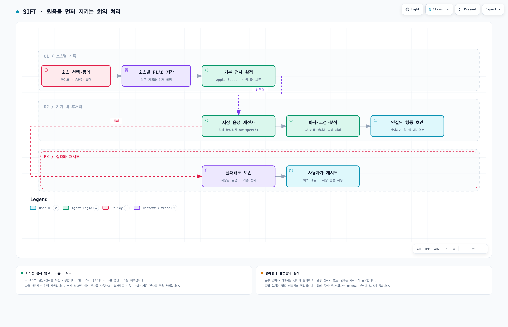
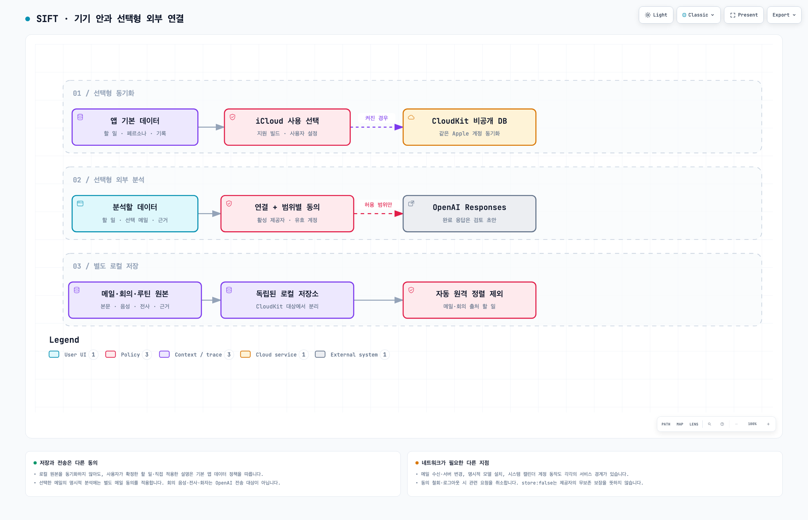

<link rel="stylesheet" href="assets/css/workflows.css">

# SIFT의 작업 흐름

입력은 가볍게, 다음 행동은 분명하게. SIFT가 **할 일·메일·회의를 어떻게 정리하고, 어디에서 사용자의 선택을 기다리는지** 세 장의 그림으로 살펴보세요.

> **읽기 전에** · 이 페이지는 2026년 10월 16일 개발 소스를 기준으로 설명합니다. App Store에 배포된 버전의 기능 목록이나 실제 기기 성능을 보증하는 문서가 아닙니다. 베타 기능은 별도 활성화·모델 설치·기기 지원 여부에 따라 달라집니다. 현재 앱의 설정과 [변경사항](changes.html)을 함께 확인하세요.

각 미리보기는 JavaScript 없이도 보이는 정적 이미지입니다. **크게 탐색하기**를 열면 확대·검색·노드 선택·관계 추적·테마 변경을 사용할 수 있습니다. 도표 내용은 한국어이며, 생성 도구의 고정 조작 UI와 HTML 언어 속성은 영어로 제공됩니다. 작은 화면이나 보조기기에서는 각 그림 아래의 **글로 읽기**가 같은 흐름을 설명합니다.

## 1. 입력에서 다음 행동까지

  <a href="assets/workflows/overview.html">전체 흐름 크게 탐색하기</a>
  <a href="assets/workflows/overview.workflow.json" download>편집 원본 JSON</a>
  <a href="assets/workflows/overview.visual-check.2048x1320.light.png" download>정적 미리보기 PNG</a>
  <a href="assets/workflows/overview.mmd" download>요약 Mermaid</a>

### 글로 읽기: 할 일·메일·루틴

1. **직접 작성한 할 일**은 제목·메모·기한과 함께 관리합니다. 정렬과 시간 제안은 규칙 또는 사용자가 허용한 모델 경로를 따릅니다. AI 점수가 할 일 자체의 존재를 결정하지 않습니다.
2. **연결한 메일**은 메일 서버에서 수신한 뒤 기기 내에서 후보와 날짜 근거를 판단합니다. 활성화·설치한 Laya의 후보 판단, 허용된 Apple Intelligence의 정리 또는 로컬 규칙을 사용합니다. 날짜가 불명확하거나 후보 판단이 불확실한 항목·홍보성 항목 등은 대기열에서 검토합니다. 조건이 충분한 메일은 진행중으로 자동 분류될 수도 있으므로, “모든 메일은 수동 승인 전까지 아무것도 생성하지 않는다”는 뜻은 아닙니다.
3. **회의에서 찾은 행동 초안**은 전사 구간과 연결됩니다. 사용자가 고른 초안을 할 일로 가져오면 먼저 검토 대기열에 들어갑니다. 오래된 전사 버전의 초안은 그대로 가져오지 않습니다.
4. **진행중 할 일**의 자동 캘린더 등록은 기본적으로 꺼져 있습니다. 설정에서 동의하고 출처 필터를 선택한 경우에만, 권한·마감·선택한 쓰기 가능한 캘린더를 확인해 새 일정을 만듭니다. 긴급·최우선도 예외가 아니며, 검토 대기·캘린더 출처·완료·건강(`health:`) 항목은 제외합니다. 자동 등록을 꺼도 기존에 연결한 일정은 삭제하지 않으며 동기화는 계속할 수 있습니다. 대상 캘린더가 사라지거나 읽기 전용이면 다른 계정으로 전환하지 않고 설정에서 다시 선택하도록 안내합니다. 완료 시 유지·알람만 끄기·삭제를 선택할 수 있으며 SIFT 소유가 확인되는 해당 일정에만 적용합니다. 알림은 별도 선택이며, 완료·삭제는 공통 변경 경로에서 기록합니다. 대기 항목은 자동 정렬·알림·자동 캘린더 등록에서 제외합니다.
5. **루틴 학습은 선택 사항**입니다. 일반 할 일의 정확히 연결된 활동별 완료 기록에서 반복 후보를 만듭니다. 사용자가 주기·시간을 검토·확정한 뒤, 개별 제안을 수락해야 새 할 일로 이어집니다. 수락은 예약 기록 → 할 일 저장 → 피드백 확정 순서로 처리합니다. 메일·회의 출처와 외부 캘린더 고정 일정 등은 학습 근거에서 제외합니다.
6. **실제 건강·운동 기록은 별도 연결**합니다. 설정에서 HealthKit 운동·복약 읽기를 각각 요청하고 출처 앱을 승인합니다. 최근 최대 90일의 반복 근거를 검토하고 제목·주기·시간·기준 날짜·시간대를 확정한 뒤 별도의 자동 생성 동의를 켜면 다음 미래 할 일을 만듭니다. 복약은 실제 복용 기록만 사용하며 처방·용량이나 누락분 보충을 추론하지 않습니다. 원본·후보는 기기 전용이고 건강 출처 할 일도 iCloud 전체 저장에서 제외합니다. 사용자가 직접 실행하는 암호화 Firebase 내보내기의 포함 범위는 동의 전에 고지합니다. 이 할 일은 일반 행동/페르소나·완료 기록 학습·자동 OpenAI 분석·자동 캘린더·자동 알림 배정에서 제외합니다.

**완료를 눌렀다는 기록은 실제 활동의 시작·종료·복약·운동·건강 상태를 측정한 증거가 아닙니다.** 루틴 제안은 확인하고 조정할 수 있는 참고 정보입니다.

## 2. 원음을 먼저 지키는 회의 처리

  <a href="assets/workflows/meeting.html">회의 흐름 크게 탐색하기</a>
  <a href="assets/workflows/meeting.workflow.json" download>편집 원본 JSON</a>
  <a href="assets/workflows/meeting.visual-check.2048x1320.light.png" download>정적 미리보기 PNG</a>

### 글로 읽기: 저장·분석·실패 복구

- **입력과 동의**: 마이크와 시스템 선택기로 승인한 출력만 기록합니다. 제3자의 대화를 녹음할 권한·동의와 현지 규칙은 사용자가 확인해야 합니다. 음성 파일 가져오기는 선택한 원본을 읽기 전용으로 열어 앱 안에 복사·변환하며, 원본 파일을 수정하거나 마이크 권한을 요청하지 않습니다.
- **원음 우선**: 녹음을 멈추면 소스별 유효한 FLAC을 명시적으로 닫아 헤더를 확정하고 복구 기록·임시 전사를 먼저 저장합니다. 원본은 계속 소스별로 보존하며 한 소스의 오류가 다른 소스의 저장·전사를 막지 않도록 분리합니다. 부모의 전체 재생과 교차 대화 타임라인은 공통 시각이 확인된 소스에서 읽기 전용으로 합성하고, 혼합 파일이나 부모 전사로 원본을 교체하지 않습니다. 전체·개별 재생은 화면을 나가면 중지합니다.
- **언어 선택과 기본 전사**: 새 녹음·가져오기의 음성·요약 언어는 앱 표시 언어와 분리한 OS 전역 선호 언어를 각 실행 가능한 지원 목록과 대조하며, 기존 사용자 선택은 유지합니다. 중복 언어 변형은 합치되 문자 체계는 구분하고, 선택 즉시 이전 화면으로 돌아갑니다. 자동 녹음은 설치·활성화한 Whisper로 소스별 약 10초 구간을 분석하며 첫 구간에 발화가 없으면 다음 구간을 기다립니다. 감지 전 앞부분도 순서대로 Apple 실시간 전사에 전달합니다. 미지원·감지 실패 시 임의의 영어로 바꾸지 않고 원음을 보존해 종료 후 처리합니다. 음성·일반 로컬 모델 설치는 설정 → 베타 기능에서만 명시적으로 실행합니다.
- **선택형 재전사**: 사용자가 고급 전사를 활성화하고 모델을 설치한 뒤 저장된 FLAC을 처리합니다. 수동은 선택한 언어로, 자동은 디코더 창별 언어 감지로 실행하며 지원하는 100개 언어는 앱 표시 언어와 독립적입니다. 모델 미설치인 가져오기·기존 기록에도 자동 모드를 저장해 설치 후 다시 시도할 수 있습니다. 실제 음성의 검증된 언어 토큰과 시간 구간을 사용하고 패딩만의 자막을 저장하지 않습니다. 성공한 새 전사는 현재 기록·선택 모드·언어 근거가 여전히 같은지 확인한 뒤 반영하며, 사용자 편집·삭제와 경합한 오래된 결과를 덮어쓰지 않습니다.
- **화자·교정·분석**: 필요한 모델과 각 베타 옵션이 허용된 경우에 처리합니다. 최종 음성 재전사·화자 처리·AI 후처리는 자원을 공유하며 트랙별로 순차 실행합니다. 회의 분석은 허용한 기기 내 모델 또는 로컬 규칙을 사용하며, OpenAI를 회의 전사 분석의 대체 제공자로 쓰지 않습니다.
- **실패 경로**: 저장 음성 재전사가 실패하면 원음·기존 전사·원본 Apple 스냅샷을 보존합니다. 쓸 수 있는 기존 전사가 있으면 활성화한 후속 처리는 그 전사를 사용합니다. 완성 전사가 없으면 음성을 남기고 회의 메뉴에서 재시도하도록 안내합니다. 저장 자체의 실패까지 성공으로 표시하거나 음성이 없는 구간을 만들어내지는 않습니다.
- **최종 선택**: 요약·행동 초안과 원문 연결을 확인하고, 필요한 행동만 할 일 대기열로 가져옵니다. 음성 내보내기는 별도의 사용자 동작입니다.
- **AI 한계**: 전사·요약·이름·할 일은 언제든 부정확하거나 누락될 수 있습니다. 선택한 요약 언어를 현재 모델이 처리하지 못하면 원문 발췌로 명시하며 번역·생성 성공으로 표시하지 않습니다. 원음·원문과 대조하고 검토 후 사용합니다.

### 기기와 배포 상태의 한계

앱 오디오 경로는 플랫폼마다 다릅니다. Mac Catalyst는 승인한 대상별 최대 4개와 별도 마이크를, iOS 27 iPhone은 단일 전체 화면 선택과 마이크를 다룹니다. iPhone에서 개별 앱이나 사람을 지정하는 기능은 아니며, iOS 26.x와 시뮬레이터는 앱 오디오 수집을 지원하지 않습니다. 이 설명은 특정 회의 앱의 실제 통화 음성 수집·다중 소스 성능을 검증했다는 뜻이 아닙니다. 마이크에 스피커 소리가 다시 들어오는 현상도 제거하지 못하므로 헤드폰을 권장합니다.

[회의 개발 마일스톤과 플랫폼 경계](meeting-milestones.html)에는 구현·계획·검증 상태를 더 자세히 구분했습니다.

## 3. 기기 안과 선택형 외부 연결

아래 도표는 전체 저장 확대 이전의 일부 동기화 범위를 기록한 자료입니다. 현재 개발 소스의 전체 저장 경계는 이어지는 표를 따르며, 새 App Store 출시를 뜻하지 않습니다.

  <a href="assets/workflows/boundaries.html">데이터 경계 크게 탐색하기</a>
  <a href="assets/workflows/boundaries.workflow.json" download>편집 원본 JSON</a>
  <a href="assets/workflows/boundaries.visual-check.2048x1320.light.png" download>정적 미리보기 PNG</a>

### 글로 읽기: 저장 위치와 동의

| 경계 | 무엇이 일어나는가 | 알아둘 점 |
|---|---|---|
| 기본 앱 저장소 | 할 일·페르소나·감사/행동·분석 기록의 정본을 항상 로컬에 유지 | 전체 저장 범위에 동의하면 별도 CloudKit 전송 저장소로 복제. 토글에 따라 빈 데이터 집합으로 전환하지 않음 |
| Firebase 수동 동기화 — 선택 | Google/Firebase 인증과 비밀번호로 보호한 암호화 스냅샷을 사용자가 업로드·다운로드 | 할 일·페르소나·행동/Audit·분석 결과 대상. 메일 전용 저장소·회의 원본·루틴 파일·OpenAI 자격증명은 제외 |
| 메일·회의·루틴·학습 원본 | 메일 원문/분석, 회의 원음·전사·화자·편집·복구 자료, 루틴·근거·피드백·예약, 개인화 사전/출처를 로컬에 저장 | 전체 저장 동의 후 같은 Apple 계정으로 복제하며, 루틴은 독립 레코드로 병합. Firebase 수동 스냅샷의 포함 범위는 별개 |
| 기기별 경계 | HealthKit 원본·후보·건강 출처 할 일, OS 권한, 재다운로드 모델 파일은 이전하지 않음 | 모델 선택 설정이 복원되어도 실제 설치·연결 전에는 선택 불가. 외부 AI·백그라운드 접근·캘린더 대상 등의 이력은 활성 권한이나 대기 작업으로 재실행하지 않음 |
| 선택형 OpenAI | 제공자 활성화, 유효한 ChatGPT 연결·구독 사용 권한, 요청 범위별 동의 확인 | 일반 할 일, 선택한 메일, 루틴 근거 요약, 페르소나/행동 설명은 각각 허용 범위만 전송. 계정 연결만으로 앱 데이터 공유 동의가 생기지 않음 |
| 자동 정렬의 출처 필터 | 메일·회의 출처 할 일을 자동 외부 우선순위 요청에서 제외 | 선택한 메일의 명시적 본문 분석은 별도 메일 동의와 요청 동작을 거침. 회의 음성·전사·화자는 OpenAI 전송 대상이 아님 |
| 캘린더 컨텍스트 | 외부 분석의 별도 캘린더 이벤트는 제목을 `Busy`로 가리고 시간 구간만 사용 | 외부 캘린더에서 가져와 확정한 일반 할 일의 제목·메모에는 일반 할 일 공유 동의가 적용될 수 있음 |
| 자격증명 | 전체 저장 동의·현재 Apple 계정 확인 후 이메일 OAuth·IMAP 앱 비밀번호·ChatGPT 등록/토큰·학습 식별 키를 iCloud 키체인으로 복원 | 수신 기기도 전체 저장과 iCloud 키체인이 필요. host ID·실행 비밀의 기기별 접근 제어는 이전하지 않으며, 제공자 활성화·외부 AI 동의는 기기별 확인 |

ChatGPT 회전 갱신은 연결을 승인한 설치 한 곳이 소유합니다. 수신 기기의 액세스 토큰이 만료되면 원래 기기에서 SIFT를 열어 갱신·동기화를 기다리거나 현재 기기에서 명시적으로 다시 연결합니다. 갱신 실패의 로컬 토큰 격리는 공유 삭제·로그아웃과 분리해 늦은 교체 토큰을 막지 않으며, 같은 세션의 이전 회전은 이미 보유한 새 자격증명으로 되돌리지 않습니다.

**“로컬 중심”은 “네트워크를 전혀 쓰지 않는다”는 뜻이 아닙니다.** 메일 서버 조회·읽음/휴지통 변경, 사용자가 연 HTML 메일의 HTTPS 리소스, 계정 인증, 명시적 모델 설치, 선택형 iCloud·Firebase·OpenAI, 캘린더 제공자의 동기화에는 외부 서비스가 관여할 수 있습니다. 모델 다운로드 요청에 회의 음성·전사·화자 데이터를 넣지는 않습니다. 가져오는 파일이 클라우드 파일 제공자에 있으면 해당 제공자가 원본을 내려받을 수도 있습니다.

OpenAI 요청은 `store:false`, `stream:true`로 보내고 완료된 응답만 검토 초안으로 돌려줍니다. 이것은 제공자 측 무보존이나 데이터 이용 정책을 보장하지 않습니다. 정확한 전송 항목·보관·삭제는 [개인정보 처리방침](privacy-policy.html)을 확인하세요.

## 4. 공개 자료와 편집 원본

이 페이지와 도표는 같은 웹사이트의 정적 파일만으로 열립니다. 비공개 저장소 로그인이나 외부 다이어그램 렌더링 서비스가 필요하지 않습니다. HTML 파일을 내려받으면 네트워크 연결 없이 도표 탐색을 할 수 있습니다. 다운로드한 HTML의 **Export** 메뉴에서 도표 전용 PNG·JPEG·WebP·SVG를 내보낼 수 있습니다. 아래 PNG는 탐색 화면의 정적 미리보기이며, 도표 전용 내보내기와 구별됩니다.

- **편집 가능한 명세**: 각 `*.workflow.json`은 Archify workflow schema v2를 사용합니다. 안정적인 노드 ID·한국어 문구·관계·차선·열 배치가 포함되어 재생성할 수 있습니다.
- **README용 요약**: [overview.mmd](assets/workflows/overview.mmd)는 핵심 분기만 담은 Mermaid 원본입니다. 전체 데이터 경계 설명은 이 페이지를 함께 연결하세요.
- **도구 범위**: 도표는 설명용입니다. 화면의 노드 선택·관계 추적은 실제 앱의 실행 상태나 데이터 전송 모니터가 아닙니다.
- **좁은 화면 도구 모음**: 배포 HTML은 생성 템플릿의 `max-width: 720px` 도구 모음에 `top: 0; right: 0; flex-wrap: wrap; width: 100%`를 적용한 별도 복사본으로 생성했습니다. 버튼이 왼쪽 밖으로 잘리거나 제목을 덮지 않도록 한 화면 배치 보정이며, 원본 명세·관계·노드 배치는 바꾸지 않았습니다. 재생성할 때 같은 보정을 유지하세요.

### 소스 근거 지도

아래는 문서 작성 시 확인한 저장소 내부 경로입니다. 공개 방문자에게 비공개 저장소 접근을 요구하지 않도록 경로를 텍스트로 제공하며, 핵심 동작은 위에서 모두 설명합니다.

| 설명 | 확인한 소스 경로 |
|---|---|
| 메일 후보·확실성·날짜 근거와 등록/대기 분류 | `ios/todo/Services/EmailIngestionEngine.swift`, `EmailAnalysisEngine.swift`, `EmailAutomationOrchestrator.swift` |
| 할 일 완료·삭제와 알림/캘린더 부수 효과 | `ios/todo/Services/TodoMutations.swift` |
| 루틴 근거 제외·확정·수락 예약 | `ios/todo/Services/RoutineLearningService.swift`, `RoutineStore.swift` |
| 소스별 원음 저장과 복구 저널 | `ios/todo/Services/MeetingCaptureCoordinator.swift`, `MeetingCaptureRecoveryStore.swift` |
| 회의 후처리 순서와 기존 전사 보존 | `ios/todo/Views/MeetingView.swift`, `ios/todo/Services/MeetingOfflineTranscriptionOrchestrator.swift` |
| 회의 로컬 분석·버전 확인 후 할 일 가져오기 | `ios/todo/Services/MeetingAnalysisEngine.swift`, `MeetingTodoImporter.swift` |
| 로컬 정본·전체 iCloud 저장·동의 경계 | `ios/todo/Services/AppDataContainer.swift`, `FullCloudSyncService.swift`, `FullCloudSyncEngine.swift`, `CloudModelCodec.swift`, `CloudPreferenceStore.swift` |
| 외부 분석 범위·출처 제외·취소 | `ios/todo/Services/OpenAIProviderService.swift`, `OpenAIRequestRegistry.swift`, `OpenAIAnalysisService.swift` |

### 도표 생성 증빙

세 HTML은 모두 Archify의 **showcase 9/9 아티팩트 검사, 구성 오류 0·경고 0**으로 생성했습니다. 자동 브라우저 증빙은 1440×900, 1600×1000, 1920×1080, 2048×1320의 밝은 테마 크기 측정과 양 끝 크기의 밝은/어두운 테마 캡처를 포함합니다. 생성 검사·브라우저 측정·이미지 육안 검토는 서로 다른 증빙입니다. 앱 빌드·실기기 회의 기능·실제 계정 추론을 검증한 결과가 아닙니다.

별도의 [이미지 검토 기록](assets/workflows/review.json)은 실제로 읽은 밝은/어두운 캡처와 해당 HTML 해시를 연결합니다. 자동 측정 JSON의 `visualReview: pending`은 자동 도구가 육안 판단을 대신하지 않는다는 표시이며 이 기록으로 덮어쓰지 않습니다.

| 도표 | 명세/HTML SHA-256·검사 영수증 | 자동 브라우저 증빙 |
|---|---|---|
| 전체 흐름 | [생성 영수증](assets/workflows/overview.delivery.json) | [측정 JSON](assets/workflows/overview.visual-check.json) · [밝고 어두운 화면](assets/workflows/overview.visual-check.html) |
| 회의 흐름 | [생성 영수증](assets/workflows/meeting.delivery.json) | [측정 JSON](assets/workflows/meeting.visual-check.json) · [밝고 어두운 화면](assets/workflows/meeting.visual-check.html) |
| 외부 연결 경계 | [생성 영수증](assets/workflows/boundaries.delivery.json) | [측정 JSON](assets/workflows/boundaries.visual-check.json) · [밝고 어두운 화면](assets/workflows/boundaries.visual-check.html) |

[앱 소개로 돌아가기](./) · [개인정보 처리방침](privacy-policy.html) · [변경사항](changes.html)
